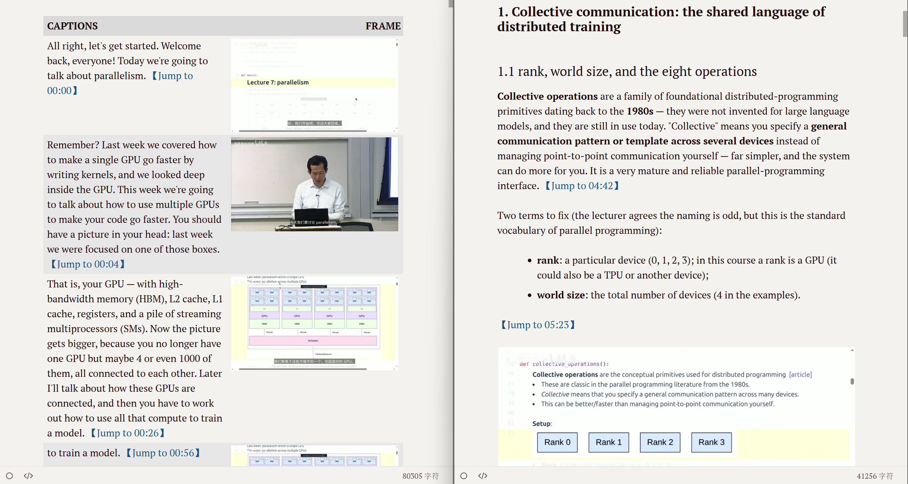

# video2blog

[](https://skills.sh/tsingyuec/video2blog-skill)


English | [简体中文](./README.zh-CN.md)

A long video keeps its information concentrated on a few dozen slides, each of which
flips past in a moment; to find a particular point afterwards, you have to watch from
the start. video2blog reorganises the material: it cuts the video where the picture
changes, and gives each segment one representative frame, the captions spoken over it
and a timestamp link back to the video, which together form the video transcript. The
post is written from that transcript alone and consults no other material, so every
sentence rests on the video's original captions. A slide that lingers still yields a
single frame, and an hour-long lecture ends up at about two hundred lines. Reading the
finished post is enough to grasp the video as a whole, and for the parts that matter,
the timestamp jumps to the corresponding point in the playback.

[Example](#example) • [Install](#install) • [How it works](#how-it-works) • [Output](#output) • [Limitations](#limitations) • [Repo structure](#repo-structure)

## Example



> The transcript is on the left; the blog written from it is on the right.

One run on Stanford CS336 *Lecture 7, Parallel training* (61 minutes, on Bilibili):

| | |
| --- | --- |
| Input | [`bilibili.com/video/BV11LEA6eEuj/?p=7`](https://www.bilibili.com/video/BV11LEA6eEuj/?p=7) |
| Transcript | [`examples/en/transcript.md`](examples/en/transcript.md), 185 windows |
| Blog | [`examples/en/blog.md`](examples/en/blog.md), 11 sections |

The transcript is a Markdown table: captions on the left, one frame on the right, one
timestamp per row. The blog keeps those timestamps inline.

Images are hosted on the `media` branch so a `--depth 1` install does not download them.

## Install

```bash
npx skills add tsingyuec/video2blog-skill
```

The CLI copies the skill into `.agents/skills/video2blog/` for the current project,
or into your global skills directory with `--global`. After that the agent loads it
whenever you paste a video link:

```
Turn this video into a blog post: https://www.bilibili.com/video/BV11LEA6eEuj/?p=7
```

<details>
<summary>Manual install, or running the scripts yourself</summary>

Python 3.9 or newer. ffmpeg is not needed: only the video stream is downloaded, and
the captions come from the platform, so there is nothing to mux.

| Package | Used for |
| --- | --- |
| `opencv-python` | frame extraction |
| `numpy` | frame comparison for de-duplication |
| `pillow` | image handling |
| `yt-dlp` | video download, YouTube captions |

```bash
pip install -r requirements.txt
# on a headless machine, use opencv-python-headless

python scripts/download_video.py   --workdir ./work --bv BV11LEA6eEuj
python scripts/extract_frames.py   --workdir ./work --bv BV11LEA6eEuj
python scripts/subtitle_fetch.py   --workdir ./work --bv BV11LEA6eEuj
python scripts/build_transcript.py --workdir ./work --bv BV11LEA6eEuj --title "Lecture 7"
```

Every script runs on its own; `python scripts/<name>.py --help` lists its options.
The full five-step workflow and its tuning parameters are in [`SKILL.md`](SKILL.md).
</details>

## How it works

```
 video URL
    │
    ├─① download ──► videos/<id>.mp4          yt-dlp, video stream only
    ├─② extract ───► frames/<id>/00012.webp   one frame per second, named by second
    ├─③ captions ──► subs/<id>.srt            Kedou on Bilibili, yt-dlp on YouTube
    ├─④ transcript ► transcripts/<title>.md   windows, merged captions, timestamps
    └─⑤ blog ──────► blog/<title>.md          written from ④
```

Steps ② to ④ carry the weight.

Frame extraction runs at 1 fps. A slide that stays up for 30 seconds therefore
produces 30 nearly identical frames. Each frame is reduced to 32×18 grayscale and
compared with its window's representative frame; a new window starts only when the
difference exceeds `--diff` and the window is at least `--minwin` seconds old. On
lecture videos that discards around 95% of the frames and keeps every slide.

Captions are machine-generated, so a window's text arrives as a run of fragments
with broken sentence boundaries. The transcript is dumped window by window,
rewritten for readability, and written back. The rewrite may smooth the text but may
not add or drop information. The blog is written after that pass, not before it.

## Output

```
<workdir>/
├─ videos/<id>.mp4                    # video stream only
├─ frames/<id>/00000.webp …           # 1 fps, filename is the second
├─ subs/<id>.srt                      # captions; Bilibili also keeps Kedou's JSON
├─ transcripts/<title>.md             # the transcript
├─ transcripts/img/<id>/xxxxx.webp    # representative frames only
└─ blog/
   ├─ <title>.md                      # the blog
   └─ assets/                         # blog images
```

## Limitations

Bilibili captions come from [Kedou](https://www.kedou.life), a free service that starts
returning `code:500 请求过于频繁` after roughly 10 calls. Wait a minute or two and
continue. YouTube may return `429` on its caption endpoint, and the scripts then fall
back to Kedou.

Kedou's request body is RSA+AES encrypted and the scripts reimplement that encryption
with the standard library. An API change breaks caption fetching until the code is
updated; see [`reference/kedou-api.md`](reference/kedou-api.md).

The scripts do not pass cookies to yt-dlp. Streams above 1080p and some videos need an
account, so `--cookies-from-browser firefox` has to be added by hand.

Frame extraction is CPU-bound: an hour of video takes minutes. Lower `--width` or
`--fps` if that is too slow.

Captions contain recognition errors. `CS336` comes through as "cs three three nox", and
names and terms are often mangled, so the rewrite pass is not optional.

Steps ④ and ⑤ run in batches of 30 to 60 windows, which keeps each tool call small at
the cost of many turns on long videos.

## Repo structure

```
SKILL.md                   # the workflow the agent follows
requirements.txt
reference/
    ├─ blog-writing.md     # writing style: pyramid structure, SCQA, glossary
    └─ kedou-api.md        # Kedou caption API: encryption and troubleshooting
scripts/
    ├─ download_video.py   # yt-dlp wrapper, video stream only, resumable
    ├─ extract_frames.py   # OpenCV frame extraction
    ├─ subtitle_fetch.py   # captions: Kedou on Bilibili, yt-dlp on YouTube
    ├─ build_transcript.py # windows, de-duplication, merged captions, timestamps
    └─ transcript_windows.py # dump and apply windows when rewriting
examples/
    ├─ zh-CN/              # example output, Chinese
    │   ├─ blog.md
    │   └─ transcript.md
    └─ en/                 # example output, English
        ├─ blog.md
        └─ transcript.md
```

## Acknowledgements

- [yt-dlp](https://github.com/yt-dlp/yt-dlp) for video download
- [kedou.life](https://www.kedou.life) for online caption extraction
- [anthropics/skills](https://github.com/anthropics/skills) for the Agent Skills standard

## License

[MIT](LICENSE)
