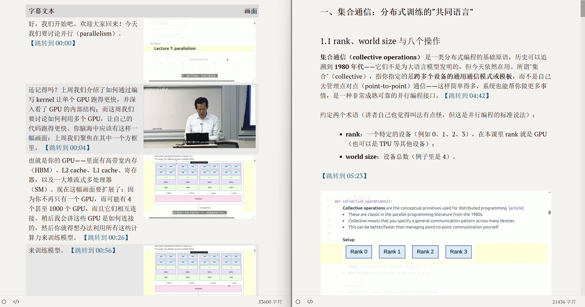

# video2blog

[](https://skills.sh/tsingyuec/video2blog-skill)


[English](./README.md) | 简体中文

长视频的信息都压在几十张幻灯片上，翻页时一晃而过，事后想找回来，只能从头再看一遍。video2blog skill 将视频素材重新组织一遍：按画面变化切分视频段，一段画面配一张代表帧、一段字幕、一个跳回原片的时间戳链接，从而得到视频文字稿。博客只依据这份文稿来写，不另找材料，每一句都能对应回视频的原始字幕。幻灯片停留再久也只取一帧，一小时的讲座最后剩下两百来行。通过阅读整理好的博客即可了解视频的整体内容，同时对于重点的那部分内容，点时间戳即可跳转到对应的视频播放点。

[示例](#示例) • [安装](#安装) • [工作流程](#工作流程) • [产物](#产物) • [已知限制](#已知限制) • [项目结构](#项目结构)

## 示例



> 左侧是文字稿，右侧是基于文字稿整理的博客

用 Stanford CS336《第 7 讲 · 并行训练》（61 分钟，源自 B 站）完整运行一次得到的产出：

| | |
| --- | --- |
| 输入 | [`bilibili.com/video/BV11LEA6eEuj/?p=7`](https://www.bilibili.com/video/BV11LEA6eEuj/?p=7) |
| 文稿 | [`examples/zh-CN/transcript.md`](examples/zh-CN/transcript.md)，185 个窗口 |
| 博客 | [`examples/zh-CN/blog.md`](examples/zh-CN/blog.md)，11 个小节 |

文稿是 Markdown 表格：左边字幕，右边一张代表帧，每行一个时间戳。博客保留这些时间戳。

图片托管在 `media` 分支，`--depth 1` 安装不会把它们一起拉下来。

## 安装

```bash
npx skills add tsingyuec/video2blog-skill
```

命令会把 skill 复制到当前项目的 `.agents/skills/video2blog/`，加上 `--global` 则装到全局。
之后把视频链接交给 agent 即可：

```
把这个视频整理成一篇博客：https://www.bilibili.com/video/BV11LEA6eEuj/?p=7
```

<details>
<summary>手动安装，或自己调用脚本</summary>

需要 Python 3.9 以上。不需要 ffmpeg：只下载视频流，字幕来自平台，没有音视频要封装。

| 依赖 | 用途 |
| --- | --- |
| `opencv-python` | 抽帧 |
| `numpy` | 帧间比较，用于去重 |
| `pillow` | 图像处理 |
| `yt-dlp` | 视频下载，YouTube 字幕 |

```bash
pip install -r requirements.txt
# 无桌面环境请改用 opencv-python-headless

python scripts/download_video.py   --workdir ./work --bv BV11LEA6eEuj
python scripts/extract_frames.py   --workdir ./work --bv BV11LEA6eEuj
python scripts/subtitle_fetch.py   --workdir ./work --bv BV11LEA6eEuj
python scripts/build_transcript.py --workdir ./work --bv BV11LEA6eEuj --title "第7讲"
```

每个脚本均可独立运行，`python scripts/<name>.py --help` 查看参数。完整的五步流程与调参
说明在 [`SKILL.md`](SKILL.md)。
</details>

## 工作流程

```
 视频链接
    │
    ├─① 下载 ──► videos/<id>.mp4          yt-dlp，仅视频流
    ├─② 抽帧 ──► frames/<id>/00012.webp   每秒一帧，文件名即秒数
    ├─③ 字幕 ──► subs/<id>.srt            B 站走 Kedou，YouTube 走 yt-dlp
    ├─④ 文稿 ──► transcripts/<标题>.md     窗口切分、字幕合并、时间戳
    └─⑤ 博客 ──► blog/<标题>.md            从 ④ 写出来
```

工作量主要在 ② 到 ④。

抽帧是每秒一张。一张幻灯片停留 30 秒，就会得到 30 张几乎一样的帧。脚本把每帧缩到 32×18
灰度，和当前窗口的代表帧算平均绝对差；差异超过 `--diff`、且当前窗口已满 `--minwin` 秒，
才开新窗口。课堂录像上大约能去掉 95% 的帧，同时不丢任何一页。

AI 字幕是机器生成的，一个窗口里的文字是一串断句错位的碎片。文稿会按窗口导出、逐窗改写通顺、
再写回；改写只负责顺句子，不能增加也不能删掉信息。博客在这一步之后才写。

## 产物

```
<workdir>/
├─ videos/<id>.mp4                    # 仅视频流
├─ frames/<id>/00000.webp …           # 1fps，文件名即秒数
├─ subs/<id>.srt                      # 字幕；B 站另存 Kedou 原始 JSON
├─ transcripts/<标题>.md              # 文稿
├─ transcripts/img/<id>/xxxxx.webp    # 只保留代表帧
└─ blog/
   ├─ <标题>.md                       # 博客
   └─ assets/                         # 博客配图
```

## 已知限制

B 站字幕来自 [Kedou](https://www.kedou.life)，一个免费服务：连续调用约 10 次后开始返回
`code:500 请求过于频繁`，等一两分钟再继续。YouTube 的字幕端点可能返回 `429`，此时脚本会
自动回退到 Kedou。

Kedou 的请求体做了 RSA+AES 加密，脚本用标准库复现了这套加密。接口一变，字幕抓取就会
失效，直到加密逻辑跟着更新，见 [`reference/kedou-api.md`](reference/kedou-api.md)。

脚本目前不给 yt-dlp 传 cookie。1080p 以上的画质和部分视频需要登录，这种情况只能自己加
`--cookies-from-browser firefox`。

抽帧受限于 CPU：一小时的视频需要运行数分钟，过慢可降低 `--width` 或 `--fps`。

字幕有识别错误。`CS336` 会变成 "cs three three nox"，人名和术语也常错，改写这一步不能
跳过。

④ 和 ⑤ 按每批 30 到 60 个窗口执行，单次调用因此不会过大，代价是长视频要跑很多轮。

## 项目结构

```
SKILL.md                   # agent 遵循的工作流
requirements.txt
reference/
    ├─ blog-writing.md     # 写作规范：金字塔结构、SCQA、术语速查表
    └─ kedou-api.md        # Kedou 字幕接口：加密原理与排查
scripts/
    ├─ download_video.py   # yt-dlp 封装，仅视频流，支持续传
    ├─ extract_frames.py   # OpenCV 抽帧
    ├─ subtitle_fetch.py   # 字幕：B 站走 Kedou，YouTube 走 yt-dlp
    ├─ build_transcript.py # 窗口切分、去重、字幕合并、时间戳
    └─ transcript_windows.py # 改写文稿时的窗口导出与写回
examples/
    ├─ zh-CN/              # 示例产出（中文）
    │   ├─ blog.md
    │   └─ transcript.md
    └─ en/                 # 示例产出（英文）
        ├─ blog.md
        └─ transcript.md
```

## 致谢

- [yt-dlp](https://github.com/yt-dlp/yt-dlp)：视频下载
- [kedou.life](https://www.kedou.life)：在线字幕解析
- [anthropics/skills](https://github.com/anthropics/skills)：Agent Skill 规范

## License

[MIT](LICENSE)
