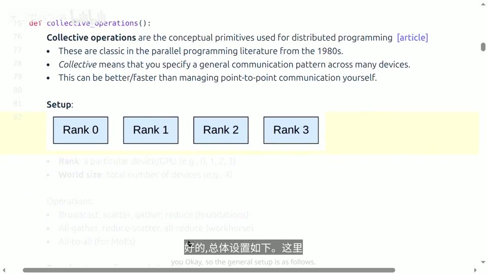
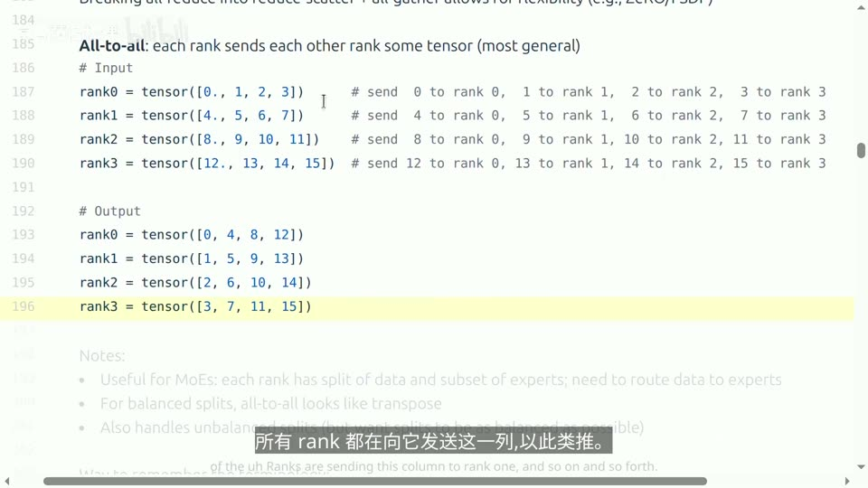
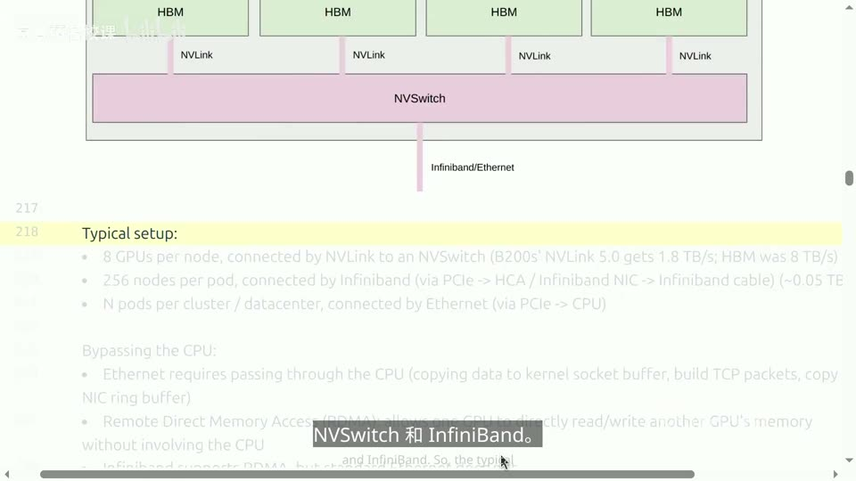
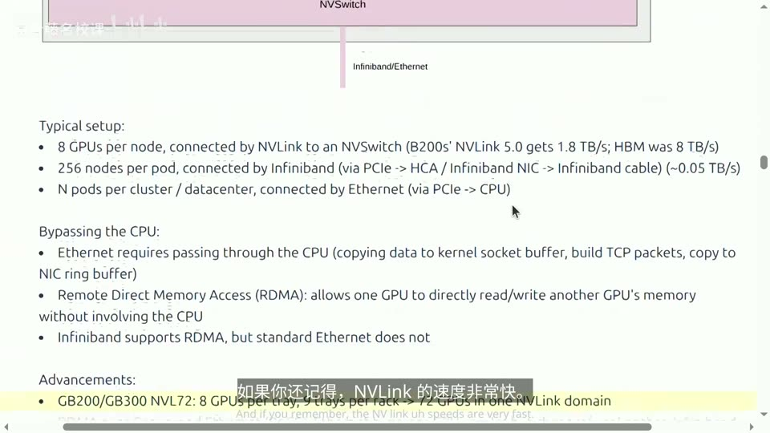
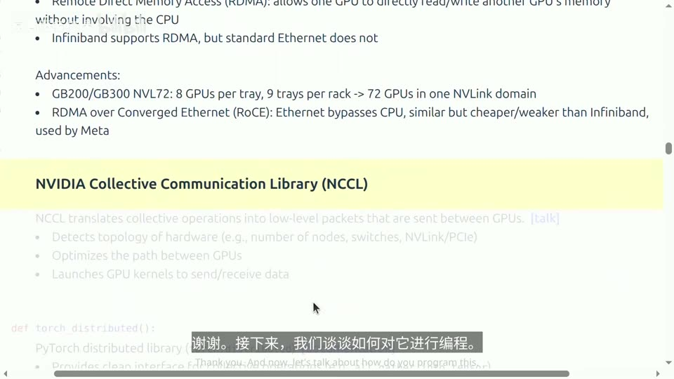
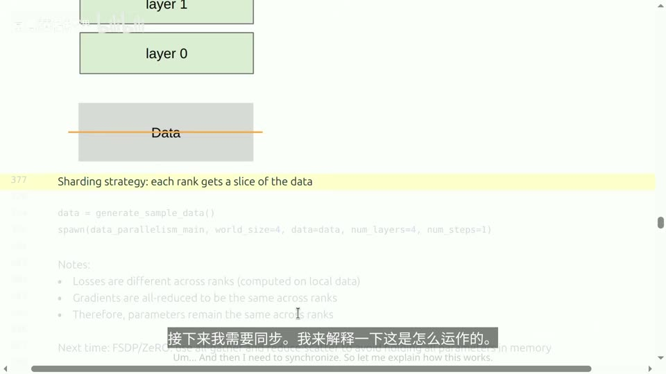
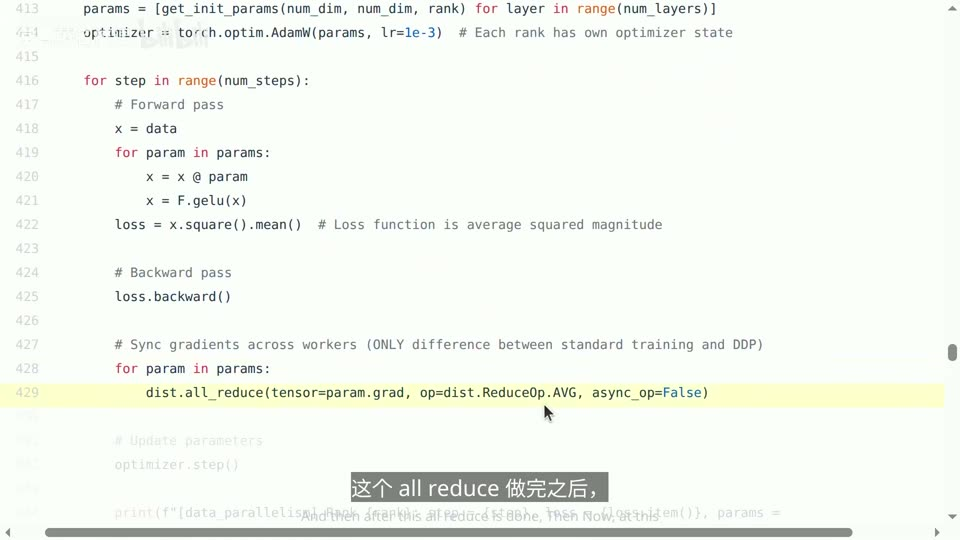
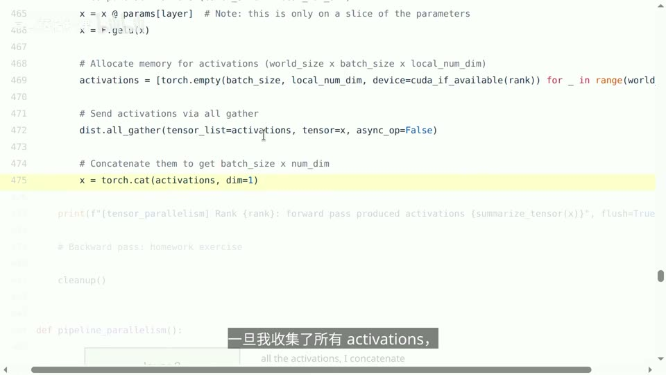

# Lecture 7: Parallel training (1) — collective communication, hardware interconnect, and data/tensor/pipeline parallelism

## The problem this lecture solves (SCQA)

**Situation**: In the previous lecture we narrowed the view to the inside of a **single GPU**, and learned to make one card go faster with kernels, tiling, shared memory and similar tricks. This lecture pulls the camera back: you no longer hold one card, but perhaps 4, 8 or even 1000 GPUs, wired to one another in various ways. [【Jump to 00:04】](https://www.bilibili.com/video/BV11LEA6eEuj/?p=7&t=4)

**Complication**: More GPUs do not automatically mean faster. The trouble comes in two kinds. First, **the model does not fit** — parameters, activations, gradients and optimizer state overflow a single card's memory (a B200 has on the order of a hundred-plus GB, and training a 1T model — one trillion parameters — on one card is simply impossible). Second, even when it fits, splitting the work across cards for **speed** costs **communication** — data has to move from one GPU to another, and moving is far slower than computing. [【Jump to 01:43】](https://www.bilibili.com/video/BV11LEA6eEuj/?p=7&t=103)

**Question**: How do we arrange computation across multiple GPUs in a sensible way — with which communication primitives, over which hardware tier, and splitting the model or the data how — so that communication does not become the bottleneck?

**Answer (conclusion first)**: The lecture gives three things. ① **Collective operations** — the basic vocabulary of distributed programming. ② **The physical links between GPUs** — the bandwidth ladder from NVLink/NVSwitch down to InfiniBand/Ethernet, which determines what can live where. ③ **Three parallelism strategies** built from scratch with `torch.distributed` — data parallelism (DDP), tensor parallelism and pipeline parallelism. One idea runs through all of it: **the further a compute unit sits from its data, the slower it goes, and every optimisation exists to keep moving data from becoming the bottleneck** — in the single-GPU era data sat far away in HBM, in the multi-GPU era it may sit on another card, and the principle does not change. Using many GPUs is easy; using them efficiently is hard. [【Jump to 01:00】](https://www.bilibili.com/video/BV11LEA6eEuj/?p=7&t=60), [【Jump to 01:25】](https://www.bilibili.com/video/BV11LEA6eEuj/?p=7&t=85)

The previous lecture's fusion and tiling were about *reducing memory accesses*; this lecture is their dual — **reduce communication volume by replicating and sharding appropriately across GPUs**. [【Jump to 02:23】](https://www.bilibili.com/video/BV11LEA6eEuj/?p=7&t=143)

> Classroom note: the example code in this lecture uses multiprocessing by default, but for line-by-line demonstration the slides show output from single-process mode. [【Jump to 03:23】](https://www.bilibili.com/video/BV11LEA6eEuj/?p=7&t=203)

---

## 1. Collective communication: the shared language of distributed training

### 1.1 rank, world size, and the eight operations

**Collective operations** are a family of foundational distributed-programming primitives dating back to the **1980s** — they were not invented for large language models, and they are still in use today. "Collective" means you specify a **general communication pattern or template across several devices** instead of managing point-to-point communication yourself — far simpler, and the system can do more for you. It is a very mature and reliable parallel-programming interface. [【Jump to 04:42】](https://www.bilibili.com/video/BV11LEA6eEuj/?p=7&t=282)

Two terms to fix (the lecturer agrees the naming is odd, but this is the standard vocabulary of parallel programming):

- **rank**: a particular device (0, 1, 2, 3); in this course a rank is a GPU (it could also be a TPU or another device);
- **world size**: the total number of devices (4 in the examples).

[【Jump to 05:23】](https://www.bilibili.com/video/BV11LEA6eEuj/?p=7&t=323)



The lecture covers eight operations. The first four are warm-up; the rest are the ones that recur in training:

| Operation | Meaning | Analogy |
| --- | --- | --- |
| broadcast | copy a tensor on one rank (say rank 0) to every rank | one person reads, everyone copies |
| scatter | split a large tensor and spread the pieces across ranks | deal a stack of cards to each player |
| gather | the inverse of scatter: collect pieces from every rank onto one rank | take everyone's cards back into one hand |
| reduce | apply a reduction (e.g. sum) over each rank's partial data and put the result on one rank | collect and sum |
| all-gather | gather onto **every** rank, so everyone holds the full data | everyone copies the full set |
| reduce-scatter | reduce each component, then scatter the results across ranks | sum in parallel, each keeps one block |
| all-reduce | reduce-scatter + all-gather: copy the reduced result to every rank | everyone holds the full sum |
| all-to-all | each rank specifies which rank receives which elements | a full exchange in one shot |

A few details on the warm-up operations:

- **broadcast** rarely appears on the critical path in training and is mostly used during initialisation — loading an initial checkpoint and broadcasting it to every rank, roughly once. [【Jump to 06:53】](https://www.bilibili.com/video/BV11LEA6eEuj/?p=7&t=413)
- **scatter** is not used directly, but it is the basis for understanding reduce-scatter; **gather** plays the same role for all-gather. [【Jump to 07:23】](https://www.bilibili.com/video/BV11LEA6eEuj/?p=7&t=443)
- **reduce** is familiar to anyone who has done functional programming: apply an operation that is **associative and commutative** (sum, max, and so on) and leave the result on a chosen rank. Interestingly, gather can also be seen as a reduce whose reduction is **concatenation**. [【Jump to 08:23】](https://www.bilibili.com/video/BV11LEA6eEuj/?p=7&t=503)
- Classroom Q&A: is broadcast here the same as NumPy broadcasting? The lecturer's answer is that they are **conceptually related** (one thing distributed to many), but the implementation differs because this is collective communication. Another student asked whether the target rank for gather/reduce is fixed — it is not; you **pass the rank at call time**, but it must be decided when you call. [【Jump to 09:10】](https://www.bilibili.com/video/BV11LEA6eEuj/?p=7&t=550)

> Mnemonic: reduce is a reduction (an operation that is associative and commutative); scatter is the inverse of gather — scatter **spreads**, gather **collects**; "all" means the target is **every** device. So all-reduce = reduce, then everyone gets it; all-gather = collect, then everyone gets it. [【Jump to 15:04】](https://www.bilibili.com/video/BV11LEA6eEuj/?p=7&t=904)

### 1.2 all-reduce = reduce-scatter + all-gather: the most important identity

**all-gather**: each rank holds one slice of the parameters or data, and after all-gather every rank holds the **complete** data. This is the foundation of the later "store sharded, collect when needed" pattern — in training you see the rhythm "gather, do something, scatter, gather, scatter" again and again. [【Jump to 09:34】](https://www.bilibili.com/video/BV11LEA6eEuj/?p=7&t=574)

![all-gather: four ranks hold the scalars 0, 1, 2, 3; after the operation every rank holds [0,1,2,3], i.e. "gather onto all ranks".](https://raw.githubusercontent.com/tsingyuec/video2blog-skill/media/assets/p07/00604.jpg)

**reduce-scatter**: reduce over **each component** of the tensor separately, then scatter the results to the ranks. In the example the four ranks hold offset vectors; summing component-wise gives [6,10,14,18], and the four components stay on four different ranks. After backpropagation, when gradients computed from different data shards must be summed and the storage redistributed, this is the operation used. [【Jump to 10:34】](https://www.bilibili.com/video/BV11LEA6eEuj/?p=7&t=634), [【Jump to 11:04】](https://www.bilibili.com/video/BV11LEA6eEuj/?p=7&t=664)

**all-reduce**: reduce over a set of tensors (say by summing) and copy the result to every rank. In the most intuitive reading it is "reduce-scatter first, then all-gather". Remember this equivalence: every clever move in the next lecture's ZeRO/FSDP is built on it — **because all-reduce splits into two steps, we can step in and shard the intermediate state**. Plain data parallelism is happy with a single all-reduce; to reach ZeRO/FSDP you have to take it apart and control it. [【Jump to 11:34】](https://www.bilibili.com/video/BV11LEA6eEuj/?p=7&t=694), [【Jump to 12:34】](https://www.bilibili.com/video/BV11LEA6eEuj/?p=7&t=754)

![reduce-scatter and all-reduce: the inputs are offset vectors on four ranks; reduce-scatter sums each component and spreads the results; all-reduce equals reduce-scatter + all-gather and copies [6,10,14,18] to every rank.](https://raw.githubusercontent.com/tsingyuec/video2blog-skill/media/assets/p07/00724.jpg)

### 1.3 all-to-all and MoE dynamic routing

**all-to-all** is the most general: each rank may hold a slice of the data or a set of experts. MoE dynamic routing ends up as a single all-to-all — each rank consults its own data to decide which activations go to which experts. With balanced load (every rank sends the same number of bytes to every other rank) it is essentially a **matrix transpose**; in practice you want the partition as balanced as possible — which is exactly why "load-balancing loss" exists in MoE. all-to-all does handle imbalance, since you can send any number of bytes to any rank, but it is most efficient when balanced. [【Jump to 13:04】](https://www.bilibili.com/video/BV11LEA6eEuj/?p=7&t=784), [【Jump to 14:34】](https://www.bilibili.com/video/BV11LEA6eEuj/?p=7&t=874)



---

## 2. Hardware interconnect: the bandwidth ladder sets the boundary of parallelism

### 2.1 From PCIe/Ethernet to NVLink/NVSwitch

To understand why parallelism costs something, first look at how well the "roads" between GPUs are built. The picture is clear inside a general memory and communication hierarchy: the most local level is registers, L1/L2 cache and shared memory inside a single GPU on a single node, and it is the fastest; moving outwards comes HBM — which we complained about last lecture and now treat as "fast storage"; further out is multi-GPU within a node, connected through NVLink to NVSwitch; outermost is multiple nodes, joined by InfiniBand or Ethernet. [【Jump to 01:30】](https://www.bilibili.com/video/BV11LEA6eEuj/?p=7&t=90)

The plainest configuration is a server with a CPU, a PCIe bus (which once carried mice and keyboards too), several GPUs and memory, with GPUs in a node talking over PCIe and machines joined by Ethernet — the lecturer's aside: this is like buying a gaming card, connecting it to a friend's machine with a network cable, and declaring that you are going to train a large model. That is the only option you have. [【Jump to 17:06】](https://www.bilibili.com/video/BV11LEA6eEuj/?p=7&t=1026)

When you get serious about training large models, the setup looks more like this ([【Jump to 18:15】](https://www.bilibili.com/video/BV11LEA6eEuj/?p=7&t=1095)):

- A node usually holds **8 GPUs**, connected by **NVLink** to an **NVSwitch**. From the programmer's view any GPU can be treated as **directly connected** to any other; the actual routing is the hardware's job. With NVLink 5.0 the total bandwidth reaches **1.8 TB/s**, against **8 TB/s** of HBM bandwidth on a B200 — NVLink is roughly a quarter of HBM (still far faster than crossing the network, and of course far slower than shared memory or L1/L2 cache).
- At cluster scale, nodes are grouped into **pods** joined by **InfiniBand** (over PCIe → HCA/network card → InfiniBand cable), with bandwidth around **0.05 TB/s**, far below NVLink; GPUs no longer connect directly, and several stages sit in between.
- Beyond that, pods talk over **Ethernet**, and the data passes through the CPU, which is slower still. It works like a memory hierarchy: the more nodes you have, the less feasible it is for one NVSwitch to serve something like 100,000 GPUs.



### 2.2 RDMA and RoCE: bypassing the CPU is what matters

One hardware detail matters a lot: **bypassing the CPU**. On conventional Ethernet a GPU must first copy its data to the CPU (the kernel socket buffer — kernel here means the operating system, not a GPU kernel), where the kernel assembles network packets and copies them to the network card, adding a lot of latency. **RDMA (Remote Direct Memory Access)** lets one GPU read and write another GPU's memory with no CPU involved. NVLink/NVSwitch and InfiniBand support RDMA natively; standard Ethernet does not, but **RoCE (RDMA over Converged Ethernet)** fills the gap — InfiniBand is expensive, and RoCE gives cheaper Ethernet much of the same performance; Meta published work in this direction, and Llama's training may or may not have used converged Ethernet. [【Jump to 20:21】](https://www.bilibili.com/video/BV11LEA6eEuj/?p=7&t=1221), [【Jump to 22:03】](https://www.bilibili.com/video/BV11LEA6eEuj/?p=7&t=1323)

Keep two groups of concepts apart: **InfiniBand, NVSwitch and NVLink describe hardware** (which cables and switches exist), while **RDMA describes the operational level** (what actually happens during communication). RDMA can be implemented in several ways: NVLink/NVSwitch is one, InfiniBand is another, RoCE yet another. [【Jump to 24:51】](https://www.bilibili.com/video/BV11LEA6eEuj/?p=7&t=1491)

### 2.3 NVL72: growing the "very fast domain" from 8 cards to 72

NVIDIA keeps pushing the size of a single domain: **NVL72**, aimed at B200/B300, uses 9 trays of 8 GPUs each to put **72 GPUs** in one NVLink domain. Physically, each tray holds two Grace CPUs, each CPU connects to 4 GPUs (hence 8 per tray), and the trays stack and all connect to NVSwitch. Ordinary users have only 8 cards inside the "very fast domain", and speed drops sharply outside the NVLink domain. [【Jump to 21:29】](https://www.bilibili.com/video/BV11LEA6eEuj/?p=7&t=1289), [【Jump to 24:28】](https://www.bilibili.com/video/BV11LEA6eEuj/?p=7&t=1468)



An extension from the Q&A: **"what if you have 9 GPUs?"** It depends on the topology. If the ninth card sits in another node and there is no NVLink/NVSwitch between the nodes, the configuration is bad — that node has little compute and very high communication cost. If every device hangs off the NVSwitch, the situation is much more reasonable. [【Jump to 26:21】](https://www.bilibili.com/video/BV11LEA6eEuj/?p=7&t=1581)

In one sentence, the bandwidth map reads: **shared memory < HBM < NVLink/NVSwitch (8 cards in a node) < InfiniBand (within a pod) < Ethernet (across pods or data centres)**. Choosing a parallelism strategy later is really the question "how fast a link does this communication need?"

---

## 3. From concept to code: NCCL and torch.distributed

### 3.1 NCCL: translating collectives into real packets between GPUs

At the bottom sits **NCCL (NVIDIA Collective Communications Library, pronounced "nickel")**: it translates all-reduce, reduce, broadcast and the other collectives into the packets that actually travel between GPUs. When you call all-reduce once, NCCL **inspects the hardware topology** (how many nodes, which switches, whether the path is NVLink or PCIe), **picks a communication path** (ring or tree) and **launches a GPU kernel** to move the data — everything on a GPU is ultimately a kernel, communication included (there are communication kernels dedicated to talking to other GPUs). [【Jump to 23:17】](https://www.bilibili.com/video/BV11LEA6eEuj/?p=7&t=1397)



A Q&A point: is NCCL optimised specifically for multi-node clusters? The lecturer's answer: he does not know the details, but NVIDIA has essentially always optimised its whole software stack for large-scale training and inference — its biggest customers are the large companies and language-model providers, so it would be surprising if it had not been optimised for exactly this workload. [【Jump to 25:51】](https://www.bilibili.com/video/BV11LEA6eEuj/?p=7&t=1551)

### 3.2 spawn and setup: the process model and the coordination channel

Above NCCL, PyTorch offers `torch.distributed`, with the backend set to **NCCL (GPU)** or **gloo (CPU)** — parallel programming predates GPUs, so collectives also run on CPUs. Because this lecture is demonstrated on a machine without multiple GPUs, it uses the gloo backend. The library also ships higher-level models and algorithms, which this course avoids in order to build from scratch. [【Jump to 27:48】](https://www.bilibili.com/video/BV11LEA6eEuj/?p=7&t=1668)

- `spawn(fn, world_size=4)` runs the function `fn` four times, each process taking one rank (0 to world_size−1). They are **asynchronous** with respect to one another and finish in any interleaving — the order in which print statements appear is an arbitrary order decided by the hardware. [【Jump to 28:25】](https://www.bilibili.com/video/BV11LEA6eEuj/?p=7&t=1705)
- `setup` configures `MASTER_ADDR` and `MASTER_PORT`. Note that it is **not** the data path between GPUs; it carries generic metadata and coordination only. Real data has to go through NCCL, or it will be very slow. [【Jump to 29:17】](https://www.bilibili.com/video/BV11LEA6eEuj/?p=7&t=1757)

### 3.3 barrier, and synchronous vs asynchronous

- `dist.barrier()` is a **synchronisation barrier**: on reaching it a process waits until every other process arrives too. Because processes are asynchronous and no completion order is guaranteed, you need it to ensure that some code runs before other code; the cost is unnecessary waiting. [【Jump to 29:47】](https://www.bilibili.com/video/BV11LEA6eEuj/?p=7&t=1787)
- **Synchronous vs asynchronous**: `dist.all_reduce(tensor, op=ReduceOp.SUM, async_op=False)` is synchronous and writes **in place** — the tensor holds the result as soon as the call returns. `async_op=True` returns immediately, you go off and do something else, and later call `wait()` to confirm completion. The typical use of the asynchronous form is **overlapping computation with communication**: issue the communication, work on independent data or computation (loading the next batch, for example), and synchronise only when the result is actually needed. [【Jump to 33:13】](https://www.bilibili.com/video/BV11LEA6eEuj/?p=7&t=1993), [【Jump to 33:50】](https://www.bilibili.com/video/BV11LEA6eEuj/?p=7&t=2030)

### 3.4 Live demo: all-reduce, reduce-scatter and all-gather

The lecturer demonstrates all-reduce: four ranks hold `[0,1,2,3]`, `[1,2,3,4]`, `[2,3,4,5]` and `[3,4,5,6]`; after all-reduce with sum, every rank holds `[6,10,14,18]` — the sum of each column, copied to every rank. [【Jump to 30:51】](https://www.bilibili.com/video/BV11LEA6eEuj/?p=7&t=1851)

Then reduce-scatter: this time **without in-place writing**, passing separate input and output tensors — the input is essentially untouched, and each component's reduced value lands on its corresponding rank. Finally the reduce-scatter output is fed into all-gather, which copies the complete data to every rank. That verifies the most important identity in code: **all-reduce = reduce-scatter + all-gather**. At the end the lecturer also calls a cleanup function (something like `destroy_process_group`) — "cleaning up after yourself is a good habit". [【Jump to 32:02】](https://www.bilibili.com/video/BV11LEA6eEuj/?p=7&t=1922), [【Jump to 34:56】](https://www.bilibili.com/video/BV11LEA6eEuj/?p=7&t=2096)

---

## 4. Measuring how fast communication is: all-reduce effective bandwidth

### 4.1 Two traps: warmup and "two layers of asynchrony"

Knowing that communication works is not enough; you have to **measure how fast it is**. Two traps to avoid when benchmarking:

- **warm up** first, because the first call usually carries initialisation overhead;
- use `torch.cuda.synchronize()` to wait for the **CUDA kernel** to really finish, and `dist.barrier()` to wait for **all processes** to reach the same point. Why both? Because there are two layers of asynchrony in the system: CUDA operations inside a process are asynchronous by default (Python may execute the next line while the kernel is still running), and the processes are asynchronous with respect to one another. A barrier alone is not enough — if the kernel is still running, each process simply crosses the barrier and no real synchronisation happens. [【Jump to 35:56】](https://www.bilibili.com/video/BV11LEA6eEuj/?p=7&t=2156), [【Jump to 40:36】](https://www.bilibili.com/video/BV11LEA6eEuj/?p=7&t=2436)

### 4.2 The formula: effective bandwidth does not depend on world size or topology

Then put a clock around the operation and compute **how many bytes were sent** and **how long it took**. The example runs all-reduce over 100 million elements and takes about 1.6 milliseconds — fast or slow? Compute the effective bandwidth:

```text
sent_bytes   = size_bytes × 2 × (world_size − 1)   # 2 = send + reduce; W−1 = reduce iterations
total_time   = world_size × duration               # weighted over all ranks
effective_BW = sent_bytes / total_time
```

Where the factors come from: merging W ranks pairwise into one sum takes W−1 iterations; each iteration both **sends** and **reduces**, hence the 2; time is weighted over world_size ranks to get the total. [【Jump to 37:28】](https://www.bilibili.com/video/BV11LEA6eEuj/?p=7&t=2248)

As `W` grows, `(W−1)/W → 1`, so **`effBW ≈ 2S / T` — effective bandwidth is independent of world size, and independent of topology (whether NCCL picks ring or tree)**. The example measures about **400 GB/s**, and the number does not degrade as GPUs are added. That is precisely why all-reduce is so widely used. [【Jump to 38:11】](https://www.bilibili.com/video/BV11LEA6eEuj/?p=7&t=2291)


### 4.3 The reduce-scatter comparison: half the work, the same bandwidth

reduce-scatter is measured similarly, but the byte count is **not** multiplied by 2 (there is only a send, no separate reduce step), and the figure is again around 400 GB/s (sometimes with some variance, roughly in the 400s). Seen from one vantage point: **all-reduce does both the reduce-scatter job and the all-gather job, so it moves twice the data — but it also takes twice the time, the two cancel out, and the bandwidth is the same.** [【Jump to 39:10】](https://www.bilibili.com/video/BV11LEA6eEuj/?p=7&t=2350), [【Jump to 39:36】](https://www.bilibili.com/video/BV11LEA6eEuj/?p=7&t=2376)

---

## 5. Data parallelism (DDP): one step beyond standard training

### 5.1 Split the data, not the model: all-reduce the gradients after backprop

The lecturer demonstrates the three kinds of parallelism on the most basic MLP — and remember that **the MLP is where the real compute bottleneck of a Transformer sits**, so the example is representative. [【Jump to 41:31】](https://www.bilibili.com/video/BV11LEA6eEuj/?p=7&t=2491)

**Data parallelism** splits the **data**: the batch dimension is cut into world_size pieces, each rank takes `batch_size / world_size` rows (a batch of 128 across 4 ranks means 32 rows each), but **every rank keeps a complete copy of the parameters**. In real training each rank normally loads its own data to avoid a bottleneck; the demo shares it only for convenience. Forward and backward passes are identical to ordinary training; the difference comes after backpropagation: all-reduce the gradients of every parameter and average them, so all ranks end up with the same gradients and, after the update, the same parameters. [【Jump to 42:15】](https://www.bilibili.com/video/BV11LEA6eEuj/?p=7&t=2535), [【Jump to 44:15】](https://www.bilibili.com/video/BV11LEA6eEuj/?p=7&t=2655)



```python
loss.backward()
# The only difference between standard training and DDP is these three lines:
for param in params:
    dist.all_reduce(tensor=param.grad, op=dist.ReduceOp.AVG, async_op=False)
optimizer.step()
```

### 5.2 The elegance is modularity; the constraint is batch size

Its elegance is **modularity**: DDP does not care what the forward pass looks like, it only synchronises parameters — swap in a Transformer and it behaves the same, forward pass unchanged, DDP averaging the parameters as before (a student asked what DDP looks like for a Transformer; the answer is that it is basically the same). Two constraints: the batch size must be **at least the world size** (otherwise some cards get no data), and preferably an integer multiple of it (otherwise you pad — possible, but integer multiples keep everything simple). [【Jump to 45:29】](https://www.bilibili.com/video/BV11LEA6eEuj/?p=7&t=2729), [【Jump to 46:01】](https://www.bilibili.com/video/BV11LEA6eEuj/?p=7&t=2761)



### 5.3 The fatal limitation: no memory savings at all

Data parallelism has one fatal limitation: **it saves no memory** — every GPU holds a full copy of the parameters, so memory grows linearly with the number of cards. The loss differs between ranks and the gradients start out different, but after the reduction they agree. If the parameters are too large to fit at all, the next lecture's ZeRO/FSDP shards that state — all-reduce behaves like a **simple monolithic operation** that requires every parameter to stay in memory. [【Jump to 46:26】](https://www.bilibili.com/video/BV11LEA6eEuj/?p=7&t=2786), [【Jump to 46:56】](https://www.bilibili.com/video/BV11LEA6eEuj/?p=7&t=2816)

---

## 6. Tensor parallelism: cut along the width, trade communication for memory

### 6.1 Column-wise splitting and all-gather

If data parallelism splits the **data**, **tensor parallelism** splits **the parameter matrix of every layer**: the data is not split, each rank holds only part of every layer's dimensions, and therefore each rank can compute **partial activations**. The cost is fixed from the start: the volume of data that usually has to be transferred is far larger. [【Jump to 47:07】](https://www.bilibili.com/video/BV11LEA6eEuj/?p=7&t=2827), [【Jump to 47:11】](https://www.bilibili.com/video/BV11LEA6eEuj/?p=7&t=2831)

Concretely (the lecture demonstrates **column-wise splitting**; row-wise works too and is left aside here): cut each layer's parameter matrix along the **columns** into world_size pieces, and rank i takes piece i. In the forward pass each rank multiplies the complete input `X` by its own piece, producing partial activations of shape `batch × local dimension`. Element-wise nonlinearities are safe to apply locally. Then **all-gather** collects the activations from every rank and concatenates them into a full-width `X` for the next layer — and this happens at every layer. [【Jump to 48:06】](https://www.bilibili.com/video/BV11LEA6eEuj/?p=7&t=2886), [【Jump to 49:36】](https://www.bilibili.com/video/BV11LEA6eEuj/?p=7&t=2976)



There is a neat duality here: **if the forward pass does all-gather, the backward pass does reduce-scatter** (gradients must be scattered back to their respective shards); and the other way round. all-gather and reduce-scatter have this complementary character. [【Jump to 51:06】](https://www.bilibili.com/video/BV11LEA6eEuj/?p=7&t=3066)

### 6.2 Manual management: the cost and the point of building from scratch

Note carefully that **everything in this lecture is managed by hand**: you do not call the usual autodiff `backward` and let it handle the distributed part; you call reduce-scatter yourself and organise the forward pass yourself. A student asked whether autograd does this — it does not, calling `backward` directly will not do any of it, because there is no parallelism in it. PyTorch does ship these capabilities, and much of the work is done for you automatically. This is deliberate: the point of the course is to build from scratch so that you can see every step, while in real use (PyTorch's own parallel APIs, for example) much of it is automatic. [【Jump to 51:36】](https://www.bilibili.com/video/BV11LEA6eEuj/?p=7&t=3096)

One more contrast is worth drawing: data parallelism is elegant because it splits by data and treats the model as one module, whereas tensor parallelism **has to operate on the model itself** — it exploits the fact that a matrix multiplication can be carried out as a set of smaller matrix multiplications, executed separately and then combined. [【Jump to 50:06】](https://www.bilibili.com/video/BV11LEA6eEuj/?p=7&t=3006)

### 6.3 The communication cost: only inside an NVLink domain

The cost is **a large volume of communication**: almost every layer transfers a considerable number of activations, at all-gather/reduce-scatter scale. Tensor parallelism is therefore usually **confined to the inside of a node** (the high-bandwidth NVLink domain), typically no more than 8 ways; once it crosses into the much slower inter-node network, performance drops sharply. It does not create pipeline "bubbles" and is simpler, but it is very bandwidth-hungry. [【Jump to 57:18】](https://www.bilibili.com/video/BV11LEA6eEuj/?p=7&t=3438)

---

## 7. Pipeline parallelism: cut along the depth, fill the bubbles with micro-batches

### 7.1 The bubble problem of the naive split

**Pipeline parallelism** cuts along **depth**: each rank owns a subset of the layers (`local_num_layers`) while every layer keeps its full width; ranks pass activations to one another with **point-to-point** send/recv — rank i receives a tensor from rank i−1, computes its layers, and sends it to rank i+1. The forward pass pushes activations forward from rank 0; the backward pass pushes partial gradients back. [【Jump to 52:36】](https://www.bilibili.com/video/BV11LEA6eEuj/?p=7&t=3156)

The most natural problem is the **pipeline bubble**: if you process one batch at a time, only one GPU is working at any moment while the rest wait idle — not computing, just waiting for another tensor, with terrible utilisation. [【Jump to 54:45】](https://www.bilibili.com/video/BV11LEA6eEuj/?p=7&t=3285)

### 7.2 Micro-batches and communication/computation overlap

The fix is the **micro-batch**: split the batch into smaller pieces (groups of 4 in the demo), let rank 0 hand a finished micro-batch to rank 1 immediately and start on the next one straight away, so that data flows continuously through the stages like a pipeline and idle time shrinks. [【Jump to 54:45】](https://www.bilibili.com/video/BV11LEA6eEuj/?p=7&t=3285)

**Overlapping communication with computation** matters especially here: make the receives and sends asynchronous (an `i` in front of the function name, as in `isend`/`irecv`) and you can send and receive while computing — "while you compute here, you can receive or send at the same time". The same holds for data parallelism: the demo does one forward pass and a single all-reduce at the end, but handled properly, a gradient can be sent the moment it is computed in the backward pass, hiding communication inside computation instead of waiting for every gradient and doing one all-reduce. This lecture leaves that for the next one. [【Jump to 55:33】](https://www.bilibili.com/video/BV11LEA6eEuj/?p=7&t=3333)

### 7.3 Where it fits: tolerating a slow network

Pipeline parallelism has the **smallest communication volume**: it only passes activations of shape `B×S×H` (batch × sequence length × hidden dimension) between stages, rather than turning an entire parameter matrix over the way all-reduce does. It therefore tolerates much slower interconnects — some **decentralised training** work uses pipeline parallelism precisely because the GPU nodes are scattered around the world, and in that setting you would never want tensor parallelism. How efficient it is depends on the batch size and the number of micro-batches: more micro-batches mean a smaller bubble fraction. [【Jump to 55:03】](https://www.bilibili.com/video/BV11LEA6eEuj/?p=7&t=3303), [【Jump to 57:22】](https://www.bilibili.com/video/BV11LEA6eEuj/?p=7&t=3442)

---

## 8. Choosing and combining: fill up data parallelism first, then stack by hardware tier

### 8.1 Hardware decides the strategy

Comparing the three strategies, the choice depends heavily on **hardware**:

- **Tensor parallelism** is bandwidth-hungry, so it lives inside the NVLink domain (inside a node);
- **Pipeline parallelism** tolerates a slow network, so it can span nodes and pods;
- **Data parallelism** is the least trouble, but is bounded by the **critical batch size**: past a point, more batch yields diminishing returns and then wastes compute — at which point tensor parallelism is the better buy. [【Jump to 57:52】](https://www.bilibili.com/video/BV11LEA6eEuj/?p=7&t=3472)

### 8.2 The usual combination, and two kinds not covered here

The usual combination goes from the inside out: **tensor parallelism within a node → data parallelism or FSDP on top → pipeline parallelism across nodes**. Two further kinds are not covered in detail here: **sequence parallelism** (splitting the sequence into chunks so that attention itself can be parallelised) and **expert parallelism** (parallelising the experts of an MoE, which is where all-to-all shines), and various combinations of these techniques appear as well — the assignments cover them. [【Jump to 56:22】](https://www.bilibili.com/video/BV11LEA6eEuj/?p=7&t=3382), [【Jump to 57:52】](https://www.bilibili.com/video/BV11LEA6eEuj/?p=7&t=3472)


### 8.3 The other road: JAX/TPU "compiler magic"

There is a more effortless road, as in JAX/TPU: you **define the model and a sharding strategy** — "this piece goes here, here and here" — and the compiler derives the required communication and does the rest of the magic. That is genuinely attractive, at the price of the pleasure and control of building from scratch. This course deliberately uses PyTorch and calls collectives in a very basic way so that you can see clearly. [【Jump to 58:22】](https://www.bilibili.com/video/BV11LEA6eEuj/?p=7&t=3502)

---

## Summary

1. **Collective communication is the language of distributed training**: broadcast/scatter/gather/reduce are warm-ups, all-gather/reduce-scatter/all-reduce carry the load, all-to-all serves MoE routing. The most important identity is **all-reduce = reduce-scatter + all-gather**, which is what makes the next lecture's ZeRO/FSDP possible.
2. **The hardware tier determines the cost of communication**: shared memory < HBM < NVLink/NVSwitch (8 cards in a node, about 1.8 TB/s on NVLink 5.0) < InfiniBand (within a pod, about 0.05 TB/s) < Ethernet (across pods). RDMA lets GPUs bypass the CPU and access memory directly; RoCE brings that to Ethernet; NVL72 stretches one NVLink domain to 72 GPUs.
3. **The programming interface has two layers**: NCCL translates collectives into real packets, probes the topology and launches communication kernels; `torch.distributed` (NCCL/gloo backends) exposes `spawn/barrier/all_reduce/all_gather/reduce_scatter`, and the asynchronous mode `async_op=True` is the basis of overlapping communication with computation.
4. **Measuring bandwidth takes care over two layers of asynchrony**: warm up first, then align the CUDA kernels and the processes with `torch.cuda.synchronize()` and `dist.barrier()`. The effective bandwidth of all-reduce is `≈ 2S/T`, **independent of world size and topology**, about 400 GB/s in the example; all-reduce does twice the work of reduce-scatter and takes twice as long, so the bandwidth comes out the same.
5. **Data parallelism (DDP)** is one step beyond standard training — "all-reduce the gradients after the backward pass". Modular and elegant, but every GPU stores a full copy, so **it saves no memory**.
6. **Tensor parallelism** cuts along the width, communicates at every layer and has to be managed by hand, with the **duality** of all-gather in the forward pass and reduce-scatter in the backward pass; it belongs inside an NVLink domain (≤ 8 ways).
7. **Pipeline parallelism** cuts along the depth, moves the least data and tolerates slow networks, but needs **micro-batches to shrink the bubbles** and depends on overlapping communication with computation.
8. **The principle for combining them**: push data parallelism as far as it goes; when memory runs out, cut with tensor parallelism inside the fast domain; then span nodes with pipeline parallelism or FSDP; and if the batch is too small, make it up with gradient accumulation.

The next lecture, by Tatsu, goes deeper into FSDP, ZeRO and the more advanced data-parallel techniques, and into genuine "4D parallelism".

---

## Glossary

| Term | One-line explanation |
| --- | --- |
| rank / world size | rank is the device index (a GPU in this course); world size is the number of devices |
| collective | a primitive that specifies a general communication pattern across several devices instead of managing point-to-point traffic by hand |
| broadcast / scatter / gather / reduce | copy to every rank / spread a large tensor / collect the pieces / reduce onto one rank |
| all-gather | every rank collects all pieces and ends up with the complete data |
| reduce-scatter | reduce each component, then scatter the results to the ranks |
| all-reduce | reduce-scatter + all-gather: copy the reduced result to every rank |
| all-to-all | each rank sends elements to chosen destinations; the communication pattern of MoE routing, a matrix transpose when balanced |
| NVLink / NVSwitch | the high-speed intra-node GPU interconnect (about 1.8 TB/s on NVLink 5.0) and its switch hardware |
| InfiniBand / Ethernet | inter-node and inter-pod networks, in decreasing bandwidth; the former supports RDMA |
| RDMA | Remote Direct Memory Access: a GPU reads and writes another GPU's memory without going through the CPU |
| RoCE | RDMA over Converged Ethernet, which lets cheaper Ethernet bypass the CPU too |
| NCCL | NVIDIA's collective communications library: translates collectives into packets and launches GPU kernels |
| gloo | PyTorch's CPU collective-communication backend |
| DDP (data parallelism) | split the batch, keep full parameters on every card, all-reduce the gradients after backpropagation |
| tensor parallelism | split each layer's parameter matrix (the width); all-gather activations forward, reduce-scatter backward |
| pipeline parallelism | split by layer (the depth), pass activations point to point, need micro-batches to reduce bubbles |
| micro-batch | a small batch carved out of a large one, used to fill the pipeline |
| bubble | idle time in a pipeline when some GPUs have nothing to do |
| effective bandwidth | bytes transferred ÷ total time; about `2S/T` for all-reduce, independent of world size |
| critical batch size | the point past which a larger batch yields diminishing returns and starts wasting compute |
