| Captions | Frame |
| :--- | ---: |
| All right, let's get started. Welcome back, everyone! Today we're going to talk about parallelism. [【Jump to 00:00】](https://www.bilibili.com/video/BV11LEA6eEuj/?p=7&t=0) | 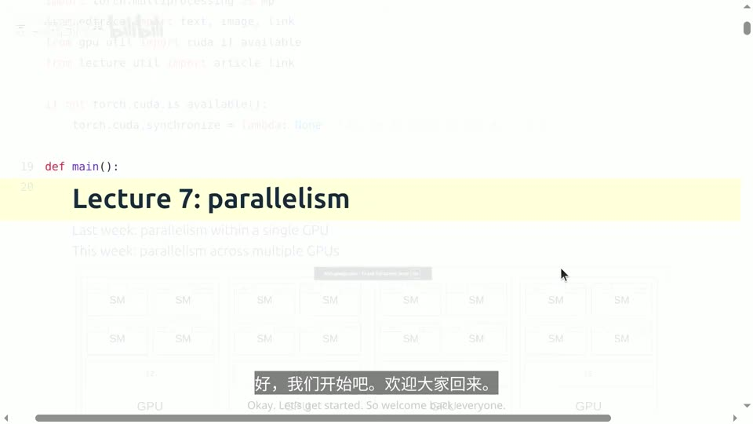 |
| Remember? Last week we covered how to make a single GPU go faster by writing kernels, and we looked deep inside the GPU. This week we're going to talk about how to use multiple GPUs to make your code go faster. You should have a picture in your head: last week we were focused on one of those boxes. [【Jump to 00:04】](https://www.bilibili.com/video/BV11LEA6eEuj/?p=7&t=4) | 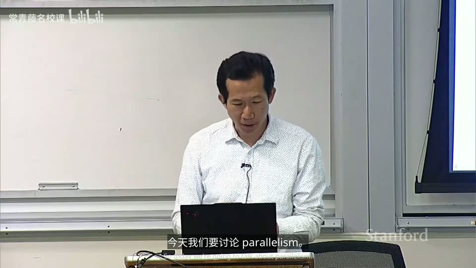 |
| That is, your GPU — with high-bandwidth memory (HBM), L2 cache, L1 cache, registers, and a pile of streaming multiprocessors (SMs). Now the picture gets bigger, because you no longer have one GPU but maybe 4 or even 1000 of them, all connected to each other. Later I'll talk about how these GPUs are connected, and then you have to work out how to use all that compute to train a model. [【Jump to 00:26】](https://www.bilibili.com/video/BV11LEA6eEuj/?p=7&t=26) | 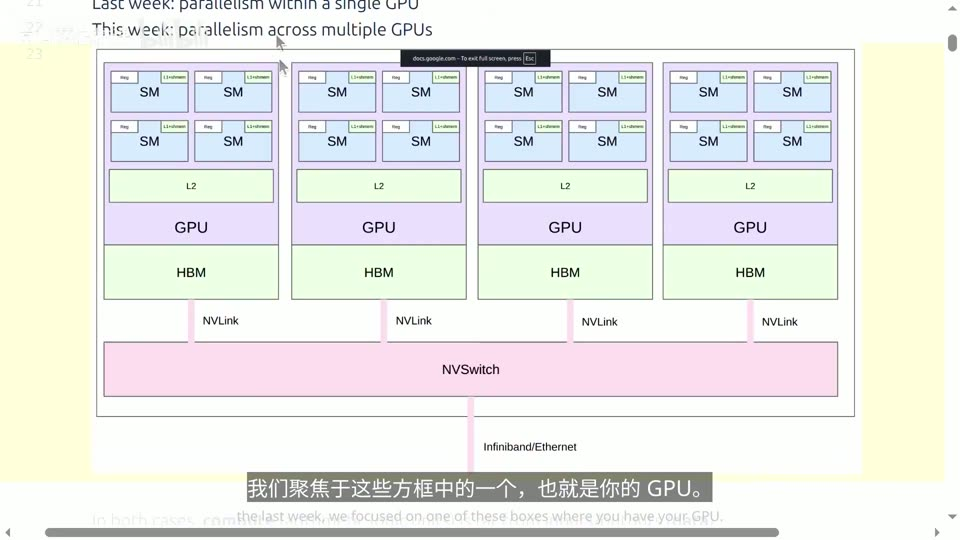 |
| to train a model. [【Jump to 00:56】](https://www.bilibili.com/video/BV11LEA6eEuj/?p=7&t=56) | 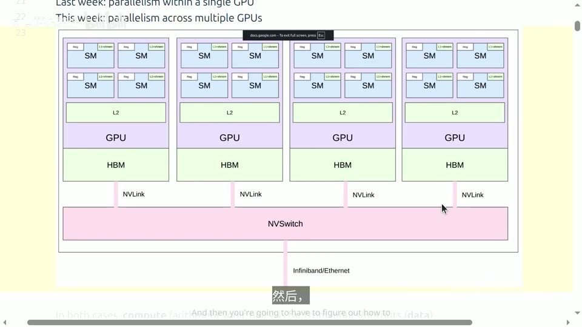 |
| So whether it's a single GPU or many — which is what we're discussing today — if you pull the camera back, the two cases are actually similar: the compute units are far from the data. [【Jump to 01:00】](https://www.bilibili.com/video/BV11LEA6eEuj/?p=7&t=60) | 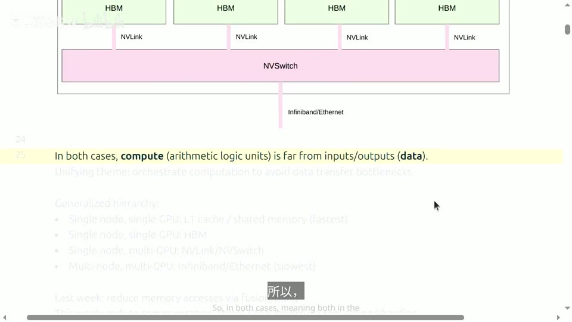 |
| When the arithmetic logic units, the Tensor Cores and so on are far from the data, in the single-GPU case that means the data sits far away in HBM; in the multi-GPU case, the data you need may be on another GPU. [【Jump to 01:11】](https://www.bilibili.com/video/BV11LEA6eEuj/?p=7&t=71) | 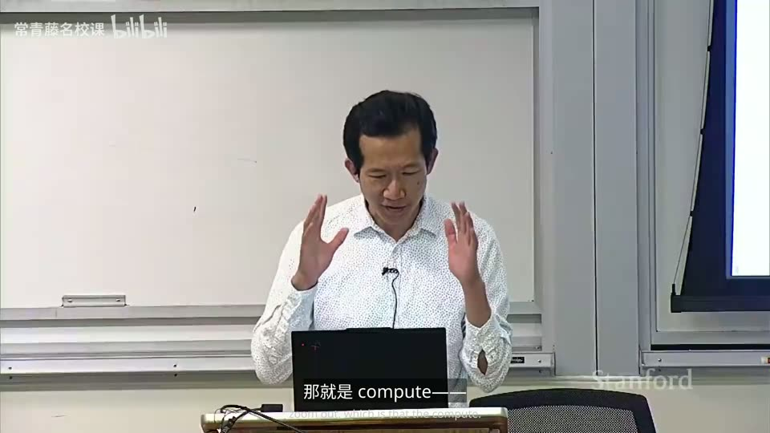 |
| You have to find some way to bring it over, but the core principle doesn't change. [【Jump to 01:25】](https://www.bilibili.com/video/BV11LEA6eEuj/?p=7&t=85) | 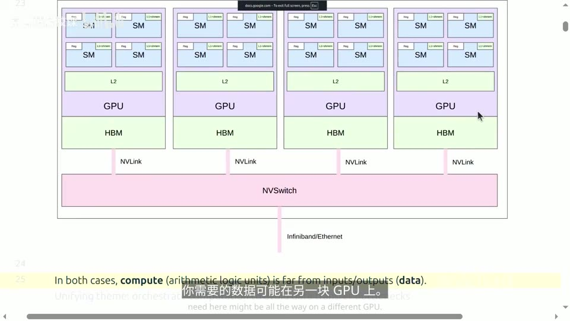 |
| The point is to arrange the computation so that moving data doesn't become the bottleneck. Using a big pile of GPUs is easy; using them efficiently is hard. So we can think more flexibly about a broad hierarchy: the most local level is inside a single GPU on a single node, with registers, L1/L2 cache and shared memory, and that's the fastest; then HBM — which we were complaining about being too slow. [【Jump to 01:30】](https://www.bilibili.com/video/BV11LEA6eEuj/?p=7&t=90) | 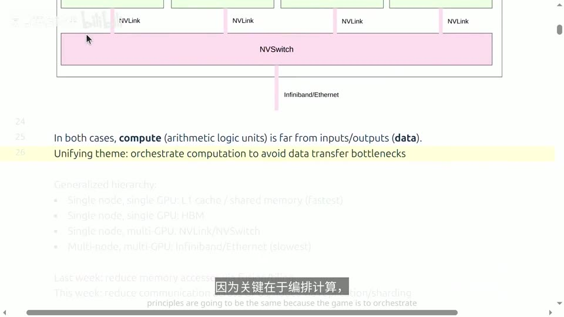 |
| But in this lecture HBM gets treated as fast storage. Then we'll look at multiple GPUs in a single node, connected by NVLink and NVSwitch; and finally multiple GPUs across nodes, where you have to pick InfiniBand or Ethernet depending on the network you have. [【Jump to 02:00】](https://www.bilibili.com/video/BV11LEA6eEuj/?p=7&t=120) | 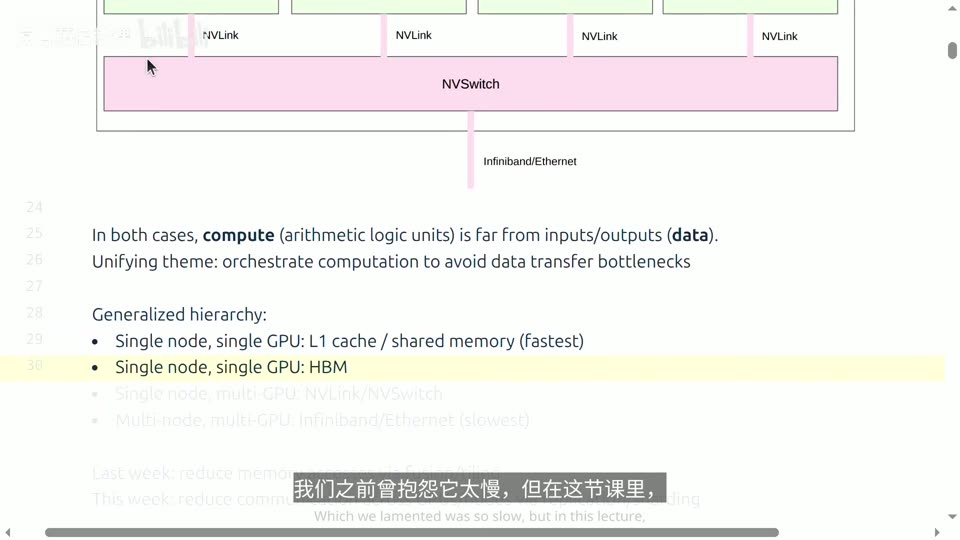 |
| Last week we discussed techniques to reduce memory accesses, namely fusion and tiling: read into shared memory, do as much as possible in there, then write back. This week we're discussing how to reduce communication volume, by replicating and sharding appropriately across GPUs. So why use multiple GPUs? The obvious answer is that you want to scale up, and more concretely there are two reasons: first, your parameters, activations… [【Jump to 02:23】](https://www.bilibili.com/video/BV11LEA6eEuj/?p=7&t=143) | 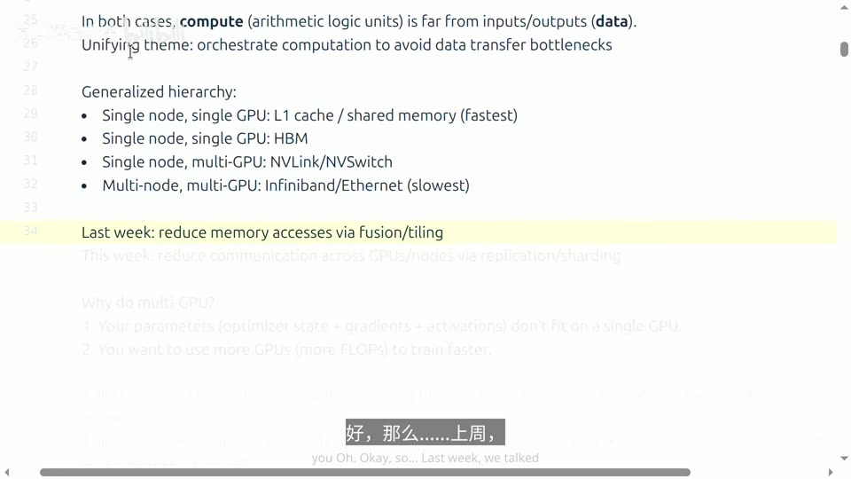 |
| …gradients and optimizer state don't fit in a single GPU's HBM. A B200 has on the order of a hundred-plus GB, and if you want to train a 1T (one trillion) parameter model, a single GPU simply can't hold it. Second, even if the model fits on one GPU, you probably want to split the work across more GPUs to train faster. So sometimes you trade off: you can fit everything on the GPU, but there aren't enough cores. [【Jump to 02:53】](https://www.bilibili.com/video/BV11LEA6eEuj/?p=7&t=173) | 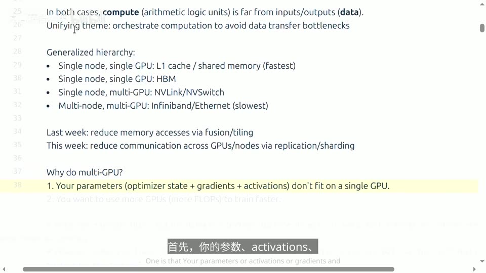 |
| But if you spread the work out, you pay for it in communication bandwidth, so you have to do the arithmetic and decide how to parallelise. One note here: this course has used Python so far, where you run the code and everything shows up. In this lecture, if you run the code directly it uses multiprocessing; but for my step-by-step demonstrations I use a special mode, single process mode. If you want to see the standard output of this lecture's code in multiprocessing mode… [【Jump to 03:23】](https://www.bilibili.com/video/BV11LEA6eEuj/?p=7&t=203) | 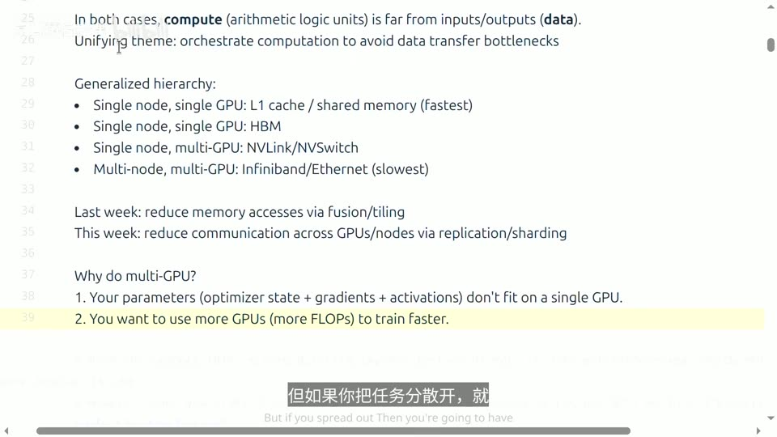 |
| …just click here. I'll demonstrate as I go, but remember: when we go step by step we're not really running multiprocessing, we're just executing the code line by line. This lecture has two parts. Part one covers the basic building blocks of distributed communication and computation — starting from the programming model, a quick word on hardware, then implementing some things in PyTorch (which is what you'll do in the assignment). Part two looks at actual training: three kinds of parallelism. [【Jump to 03:53】](https://www.bilibili.com/video/BV11LEA6eEuj/?p=7&t=233) | 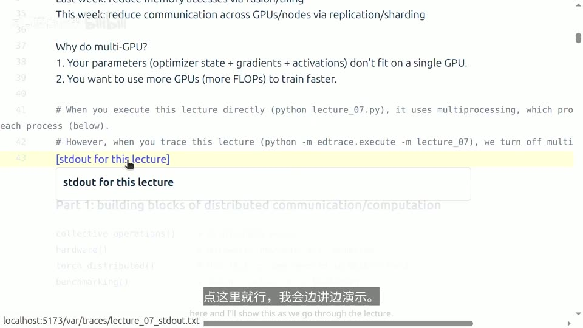 |
| Data parallelism, tensor parallelism and pipeline parallelism, each splitting the model in a different way. We'll use an MLP rather than a full Transformer as the example, but what's shown here really is the core computation. All right, let's dig in. First we need to talk about these things called collective operations. [【Jump to 04:23】](https://www.bilibili.com/video/BV11LEA6eEuj/?p=7&t=263) | 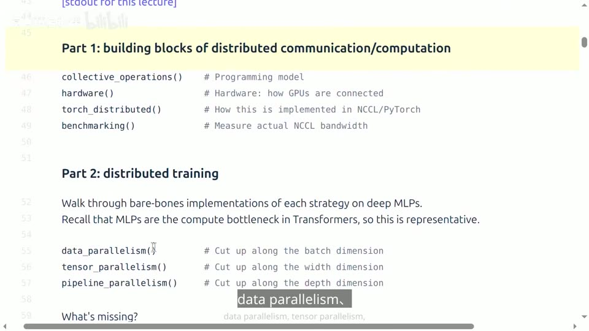 |
| Collective operations are some of the fundamental language of distributed programming, going back to the 1980s — parallel programming is a very old idea, they weren't invented to train large language models, and we're still using the same language today. "Collective" here means you specify a general communication pattern or template across multiple devices, rather than managing point-to-point communication — that is, you don't worry about exactly how this GPU talks to that one. [【Jump to 04:42】](https://www.bilibili.com/video/BV11LEA6eEuj/?p=7&t=282) | 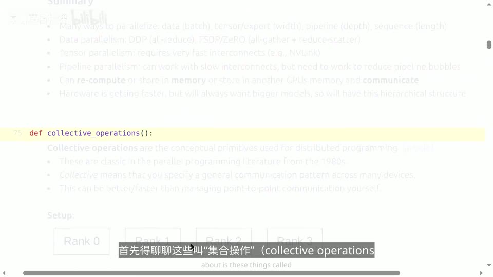 |
| That's much simpler, and the system can do more for you. So it's a very mature and reliable parallel-programming interface. OK, here's the overall setup. [【Jump to 05:12】](https://www.bilibili.com/video/BV11LEA6eEuj/?p=7&t=312) | 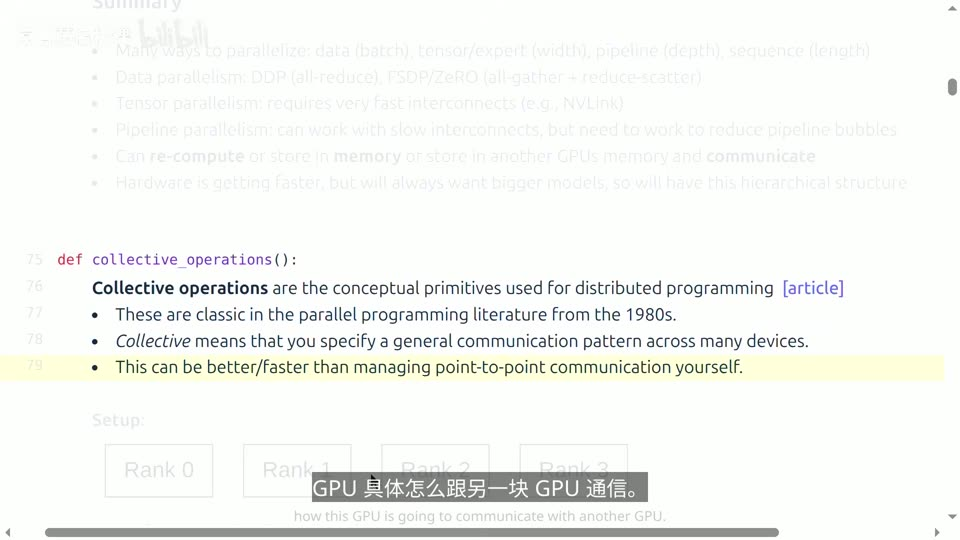 |
| I find the terminology a bit odd, but it's the standard vocabulary of parallel programming. The core idea: you have a set of ranks, each rank is a particular device (a GPU or a TPU in the examples), and the point here is that there are 4 ranks; world size is the number of devices, so world size is 4 here. We'll go through several operations: broadcast, scatter, gather, reduce, all-gather, reduce-scatter, all-reduce and all-to-all — each of which specifies… [【Jump to 05:23】](https://www.bilibili.com/video/BV11LEA6eEuj/?p=7&t=323) | 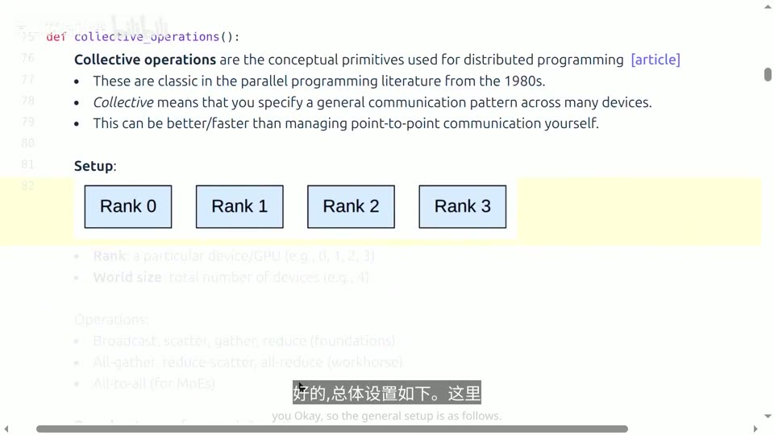 |
| …how this set of ranks (or devices) moves some amount of data to another set, or performs a computation. The first three, broadcast, gather and reduce, are really warm-ups to give you a feel for how collective communication works. In distributed training of language models, all-gather, reduce-scatter and all-reduce come up again and again. [【Jump to 05:53】](https://www.bilibili.com/video/BV11LEA6eEuj/?p=7&t=353) | 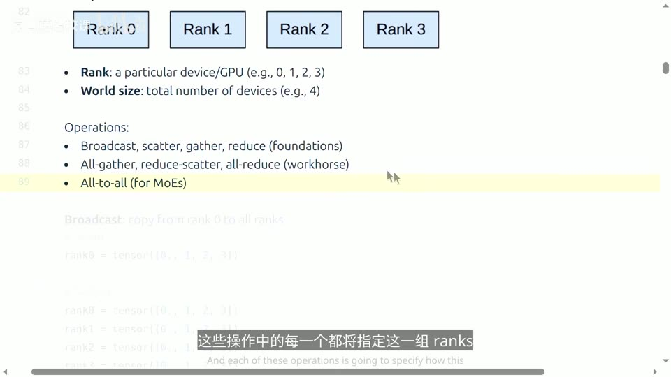 |
| Finally all-to-all, which I'll mention briefly — it matters for MoE, but we won't spend much time on it today. Let's start with the simplest operation: broadcast. In a broadcast there is a rank zero — it could be any rank, but let's say rank zero — holding the tensor [0,1,2,3], and it broadcasts it to all the ranks, and after the operation… [【Jump to 06:23】](https://www.bilibili.com/video/BV11LEA6eEuj/?p=7&t=383) | 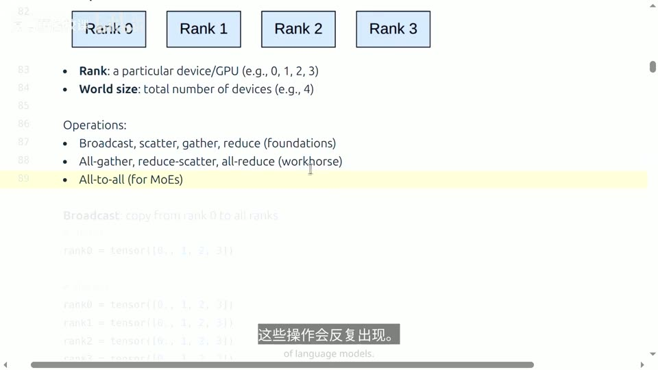 |
| …every rank has the same data. That's pretty straightforward, and it doesn't show up on the critical path of training: broadcast is mostly used during initialisation, loading an initial checkpoint and broadcasting it to all ranks, so it happens roughly once. The second operation is scatter: rank zero has a big tensor and cuts it into world_size pieces. [【Jump to 06:53】](https://www.bilibili.com/video/BV11LEA6eEuj/?p=7&t=413) | 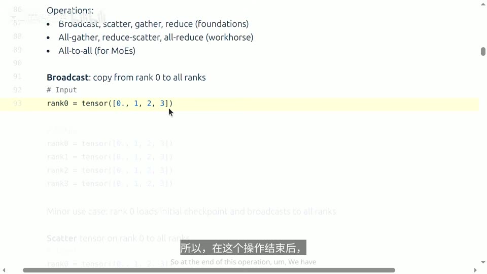 |
| Then it scatters the tensor across the ranks: rank zero gets piece 0, rank one gets piece 1, rank two gets piece 2, rank three gets piece 3. Again, scatter isn't used directly, but it's an important stepping stone to understanding reduce-scatter. As the name says, scatter spreads a big tensor from one place to many — and you can see why that's useful: you want all the GPUs taking part to compute locally on their own part. [【Jump to 07:23】](https://www.bilibili.com/video/BV11LEA6eEuj/?p=7&t=443) | 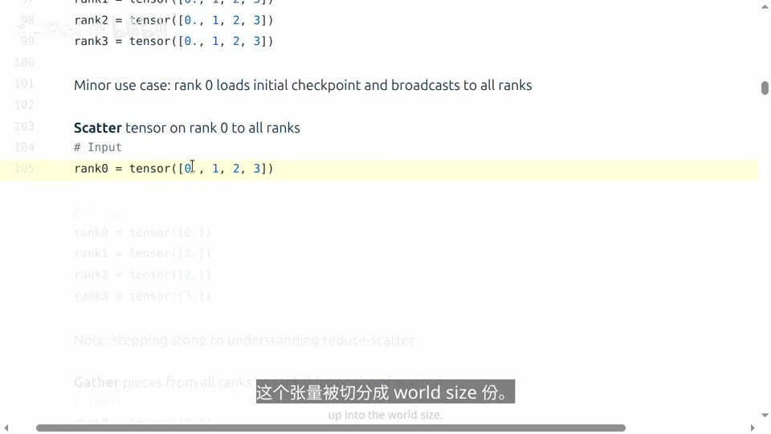 |
| Good. The inverse of scatter is gather, which shouldn't be hard to guess: the input is a pile of pieces of data, each sitting on a particular rank; when you gather — relative to a particular rank, say rank zero — it just concatenates all the pieces. gather isn't used directly either, but it's the stepping stone to all-gather. Next is reduce, and anyone who has done functional programming… [【Jump to 07:53】](https://www.bilibili.com/video/BV11LEA6eEuj/?p=7&t=473) | 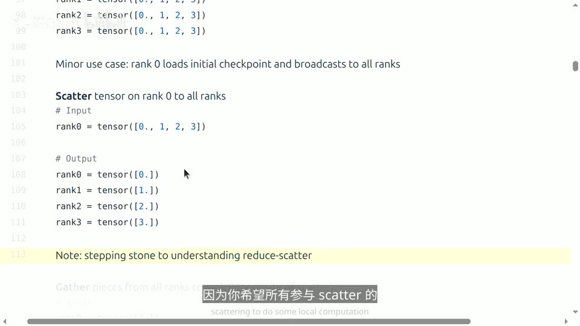 |
| …is probably familiar with reduce, and the idea is exactly the same, starting from the same place as gather: when the data is spread across devices, each rank holds part of it, and then you apply a reduction to that data and put the result on rank zero. So if you reduce by summing, adding everything up gives 6. You can also see gather as a reduction whose operation is concatenation. [【Jump to 08:23】](https://www.bilibili.com/video/BV11LEA6eEuj/?p=7&t=503) | 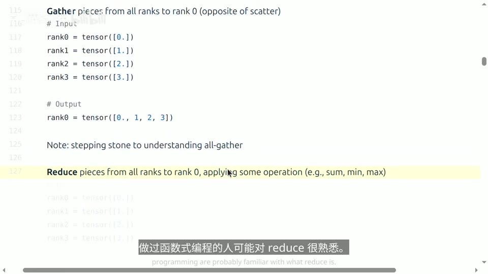 |
| And of course reduce matters for understanding all-reduce. OK, let me pause — these are just warm-ups, in case anyone still has questions about what a collective operation is: broadcast, scatter, gather and reduce matter for what follows. [【Jump to 08:53】](https://www.bilibili.com/video/BV11LEA6eEuj/?p=7&t=533) | 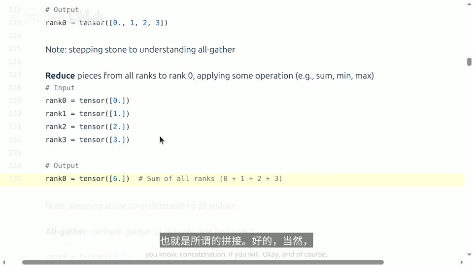 |
| (A student asks) Is this related to broadcasting and NumPy? I'd say conceptually it's the same idea — one thing handed to many things, as when a scalar is broadcast into a tensor in NumPy; but the implementation differs a little, because this is collective communication. OK, let's move on to something more interesting. [【Jump to 09:10】](https://www.bilibili.com/video/BV11LEA6eEuj/?p=7&t=550) |  |
| Next is all-gather: essentially it's gather performed on all ranks, not just collected onto rank zero. Remember what gather does? It collects all the different pieces onto one rank, rank zero; all-gather does that for every rank. That's what the "all" in the name means: send all the outputs to all the ranks, whereas gather is just the operation you perform across ranks. [【Jump to 09:34】](https://www.bilibili.com/video/BV11LEA6eEuj/?p=7&t=574) | 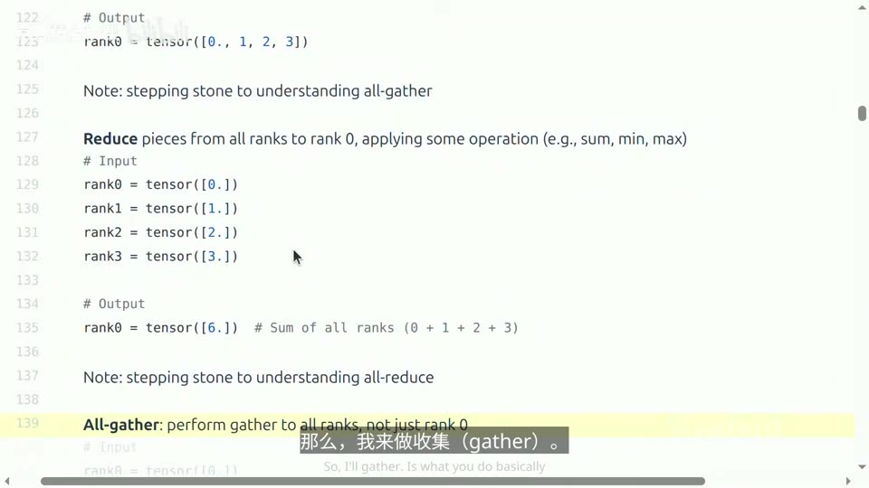 |
| This comes up a lot later, and you don't need to fully get it now. Later we'll see each rank holding only part of the parameters and needing all-gather to collect them into the full parameters a forward pass requires. So during training we usually see a pattern like this: gather, do something, scatter, gather, scatter. OK, next is reduce-scatter… [【Jump to 10:04】](https://www.bilibili.com/video/BV11LEA6eEuj/?p=7&t=604) | 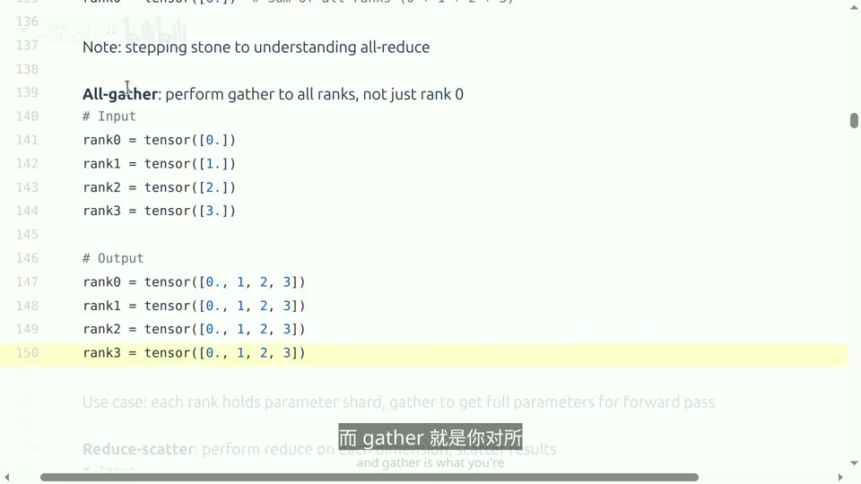 |
| …scatter applies a reduce along each dimension and then scatters the result out. Suppose you have four devices, each holding some vectors: when we did reduce earlier we reduced everything into a single 6, but reduce-scatter means doing one reduce per component of the tensor. [【Jump to 10:34】](https://www.bilibili.com/video/BV11LEA6eEuj/?p=7&t=634) | 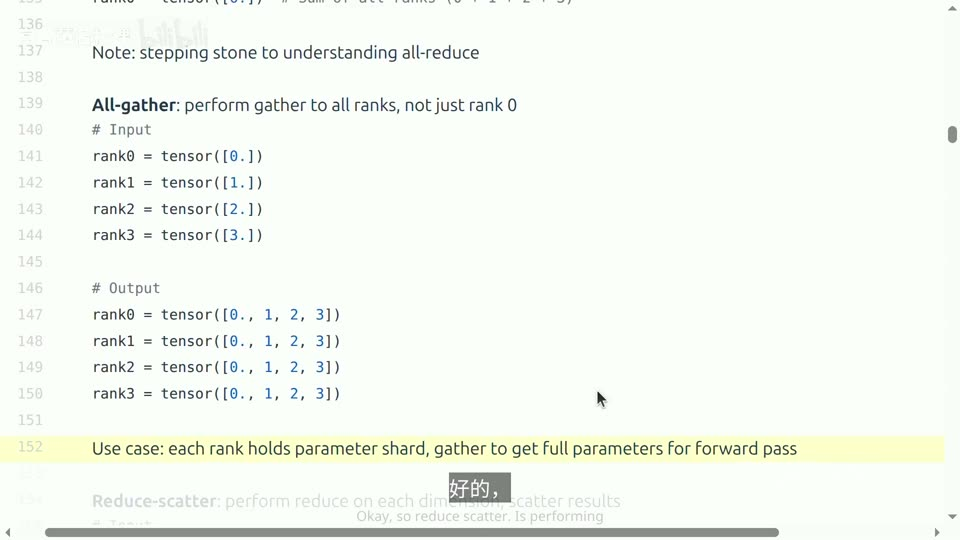 |
| Then the results land in different places: the first component sums to 6, the second to 10, the third… the fourth…. Let me set up where this shows up: after backpropagation, when you sum gradients, each GPU has processed different data… [【Jump to 11:04】](https://www.bilibili.com/video/BV11LEA6eEuj/?p=7&t=664) | 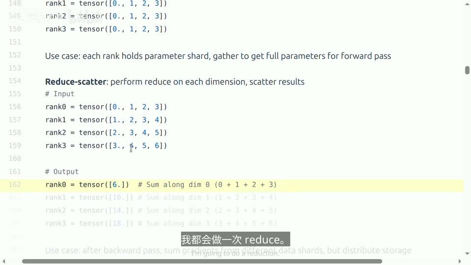 |
| Right, what you do is add up all the gradients from the different shards and then redistribute the storage of those gradients. Last is all-reduce: if you understand reduce, gather and all-gather, it's essentially one followed by the other. It performs reduce-scatter with the same input as before… [【Jump to 11:34】](https://www.bilibili.com/video/BV11LEA6eEuj/?p=7&t=694) | 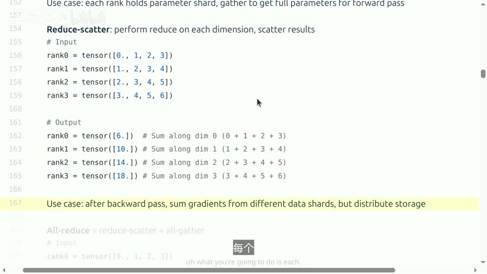 |
| …the elements are spread across different ranks, and then the all-gather step of all-reduce collects them all onto the same node. Seen that way, all-reduce is actually the easiest to understand: you have a pile of tensors, you reduce them (by summing, say), and then you copy the result to every node. When we do data parallelism… [【Jump to 12:04】](https://www.bilibili.com/video/BV11LEA6eEuj/?p=7&t=724) | 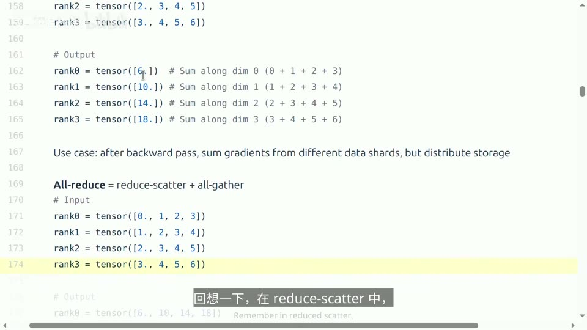 |
| …we'll see this operation first: sum the gradients, then copy the full parameters. So really we should start here, and for now keep your attention on all-reduce; later we'll see how to step up to more advanced techniques like ZeRO or FSDP — we need to break all-reduce into reduce-scatter and all-gather, because that's how we can step in and take control. For the basic version, all-reduce is enough. [【Jump to 12:34】](https://www.bilibili.com/video/BV11LEA6eEuj/?p=7&t=754) | 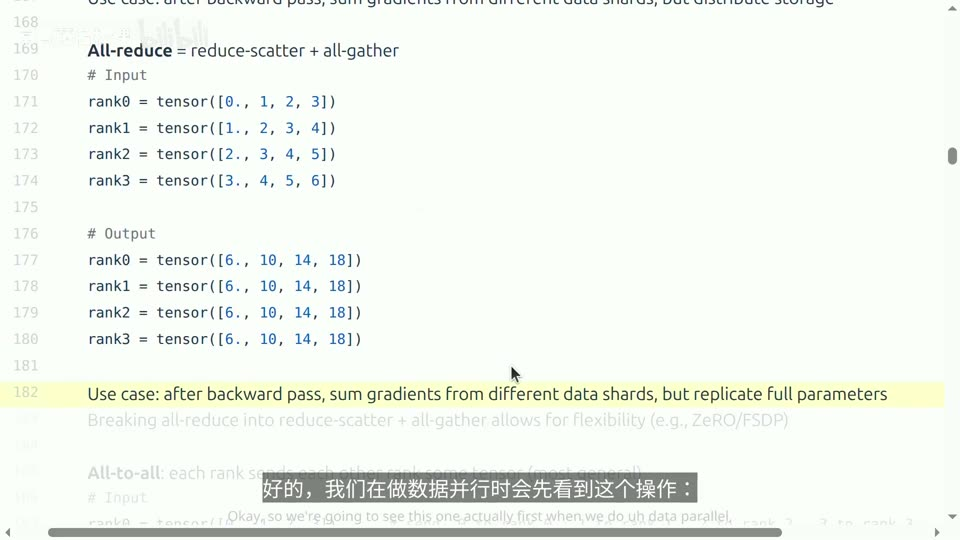 |
| Finally all-to-all: in some sense it's the most general, since you specify how each rank sends particular messages to another rank. Here's a simple example, with the same input as before: I want to send the element at position 0 to rank 0 (keep it myself), position 1 to rank 1, position 2 to rank 2, position 3 to rank 3; if I'm rank 1, I send the element at position 4 to rank 0… [【Jump to 13:04】](https://www.bilibili.com/video/BV11LEA6eEuj/?p=7&t=784) | 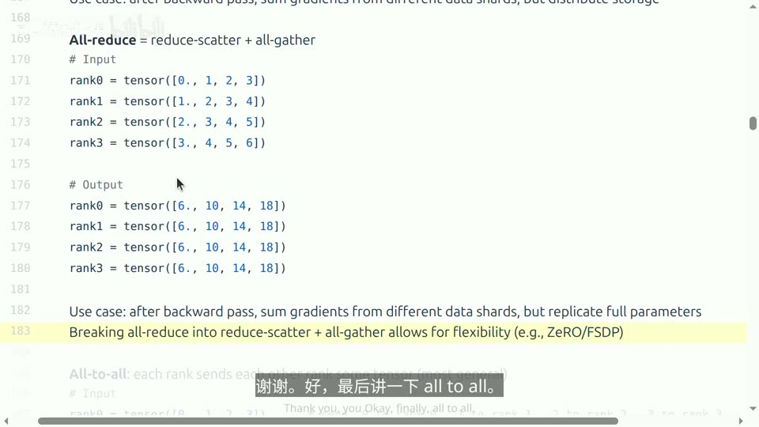 |
| …position 5 to rank 1, position 6 to rank 2, position 7 to rank 3. Basically the position says which rank is the final recipient. Look at the output and you'll see: the first rank receives everything sent from "column 0", because every rank is sending to rank 0; likewise for rank 1, every rank sends it that column. [【Jump to 13:34】](https://www.bilibili.com/video/BV11LEA6eEuj/?p=7&t=814) | 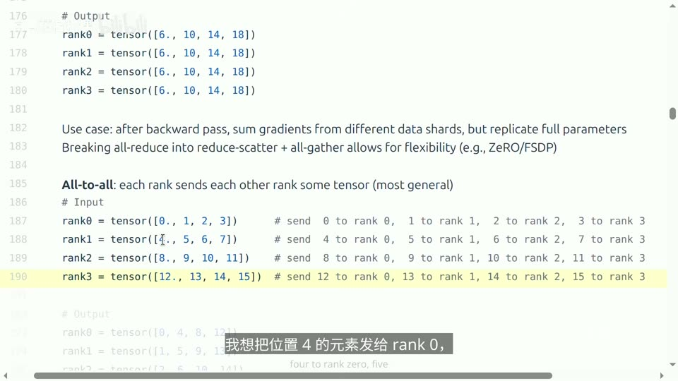 |
| And so on. This is very useful in training. Here's the intuition: each rank holds both a slice of the data and a subset of the experts — the core idea of MoE is some kind of dynamic routing, where you look at your own data to decide which activations go to which experts, and it all ends up as an all-to-all. Assuming everything is load-balanced, meaning each rank sends the same number of bytes to every other rank… [【Jump to 14:04】](https://www.bilibili.com/video/BV11LEA6eEuj/?p=7&t=844) | 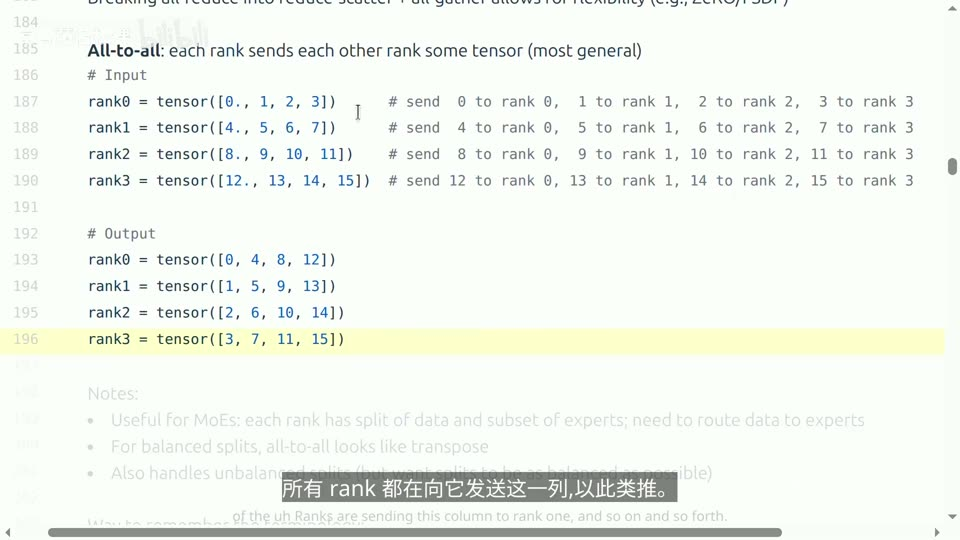 |
| …then throughout you can essentially see it as a transpose: if you think of it as a matrix, all you're doing is transposing it. In general all-to-all does handle imbalance — it isn't shown here, but you can configure it to send any number of bytes to any other rank — though it's best to make the partition as balanced as possible. Recall the load balancing from the MoE lecture: the goal is to keep the parts as even as possible. [【Jump to 14:34】](https://www.bilibili.com/video/BV11LEA6eEuj/?p=7&t=874) | 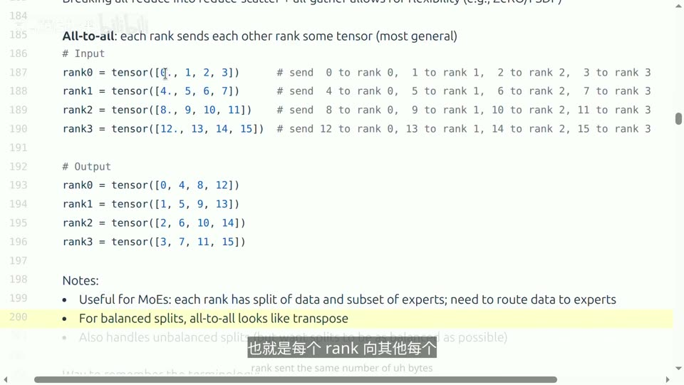 |
| So in the end, the ideal is to make the all-to-all roughly balanced. Let me summarise: I've just been through a lot of different concepts, so here are some tips for remembering the terminology. First, reduce… [【Jump to 15:04】](https://www.bilibili.com/video/BV11LEA6eEuj/?p=7&t=904) | 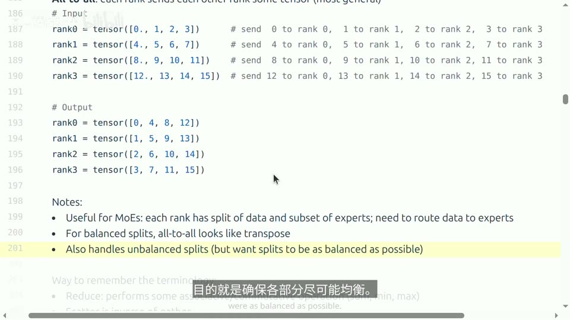 |
| …it does a reduction: it applies an operation that is associative and commutative, which could be sum, max and so on. scatter is the inverse of gather — scatter spreads data out, gather collects it in; and "all" means the target is all nodes, all devices, which explains the names all-reduce and all-gather. OK, let me pause here. [【Jump to 15:19】](https://www.bilibili.com/video/BV11LEA6eEuj/?p=7&t=919) | 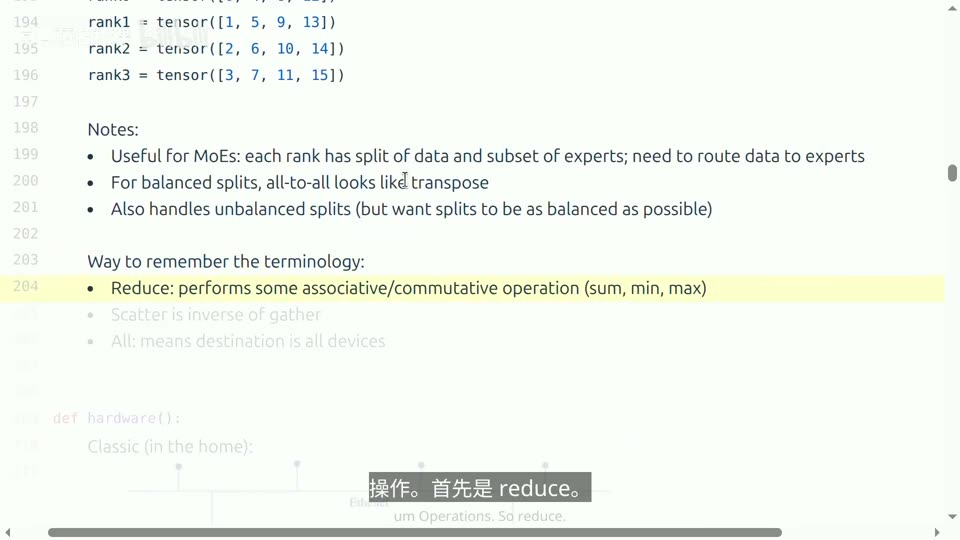 |
| Does anyone have questions about collective communication? For example, in an operation like gather… [【Jump to 15:41】](https://www.bilibili.com/video/BV11LEA6eEuj/?p=7&t=941) | 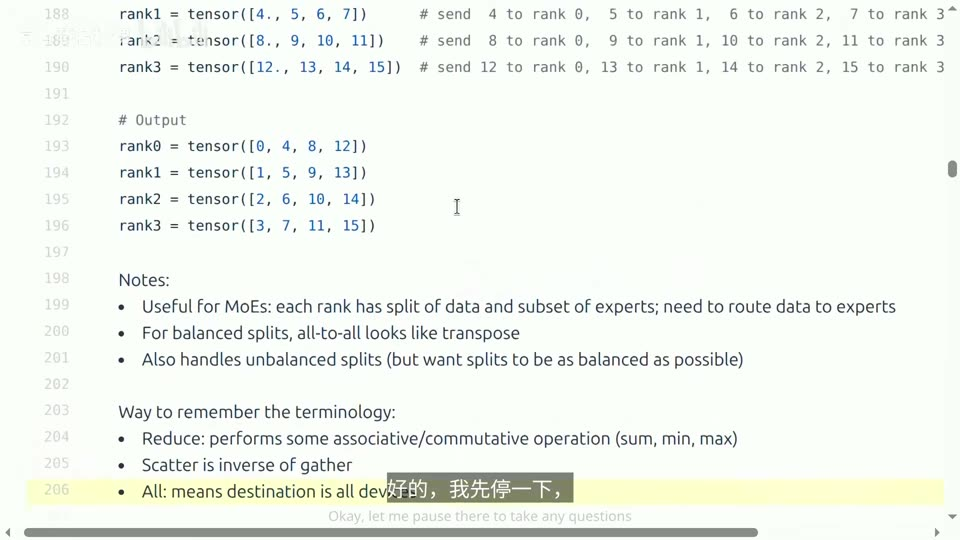 |
| …we usually want the data from all the ranks… [【Jump to 15:45】](https://www.bilibili.com/video/BV11LEA6eEuj/?p=7&t=945) |  |
| …collected onto rank zero… [【Jump to 15:49】](https://www.bilibili.com/video/BV11LEA6eEuj/?p=7&t=949) |  |
| …is that target rank fixed, meaning it's the same particular GPU every time? [【Jump to 15:53】](https://www.bilibili.com/video/BV11LEA6eEuj/?p=7&t=953) |  |
| Or can it change? — Yes. Your question is about where the output is written when you gather, or reduce onto a target. [【Jump to 15:57】](https://www.bilibili.com/video/BV11LEA6eEuj/?p=7&t=957) | 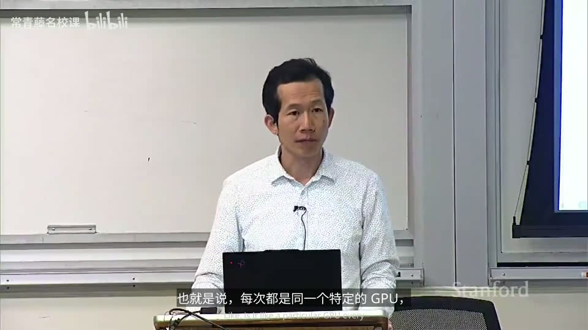 |
| I said rank zero earlier. When we look at the code you'll see: you just specify the GPU ID or rank and the data goes there. So it doesn't have to be fixed far in advance, but it must be decided when you make the call. [【Jump to 16:09】](https://www.bilibili.com/video/BV11LEA6eEuj/?p=7&t=969) | 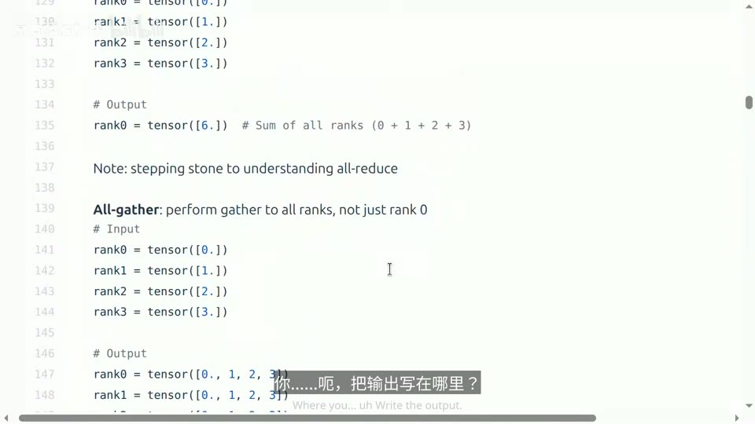 |
| Any other questions? — These are conceptual building blocks. Someone asks whether they're just concepts or actual code? What's on screen now is only the conceptual building blocks. [【Jump to 16:32】](https://www.bilibili.com/video/BV11LEA6eEuj/?p=7&t=992) |  |
| But we'll see soon how they're implemented in code. OK, before we get to code I want to talk about hardware, specifically how GPUs are connected to each other — because we already know what's inside a GPU. Let's talk about the network, which looks roughly like this… [【Jump to 16:49】](https://www.bilibili.com/video/BV11LEA6eEuj/?p=7&t=1009) | 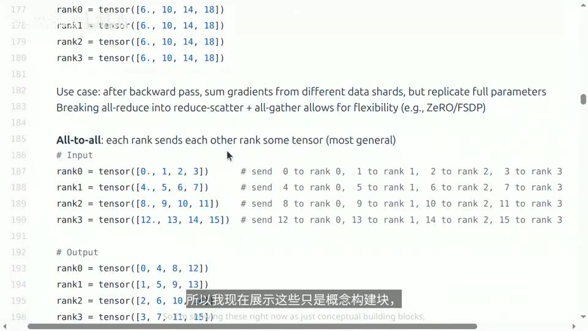 |
| This is a very classic diagram. From this rather old picture you can see how computers used to work: a server, a bunch of CPUs, a PCIe bus — which connects all sorts of devices and used to carry mice and keyboards too — a bunch of GPUs hanging off it, and some RAM. [【Jump to 17:06】](https://www.bilibili.com/video/BV11LEA6eEuj/?p=7&t=1026) | 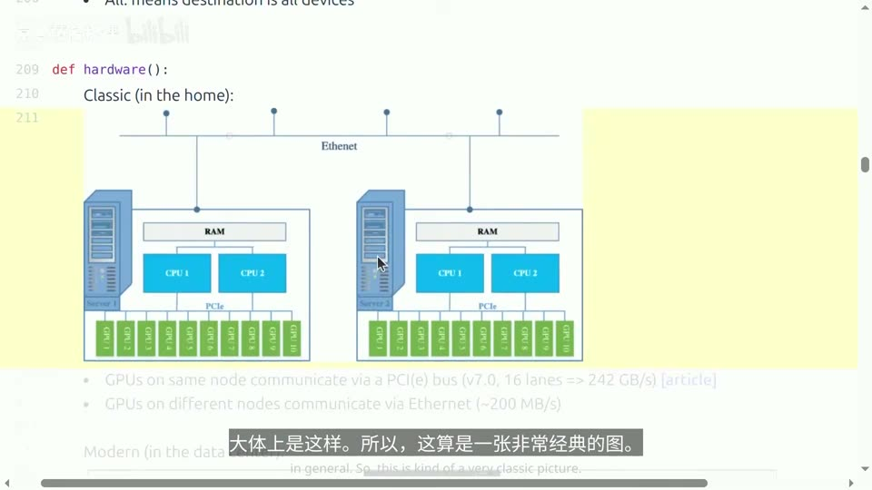 |
| And then this computer connects to another computer over Ethernet… [【Jump to 17:31】](https://www.bilibili.com/video/BV11LEA6eEuj/?p=7&t=1051) | 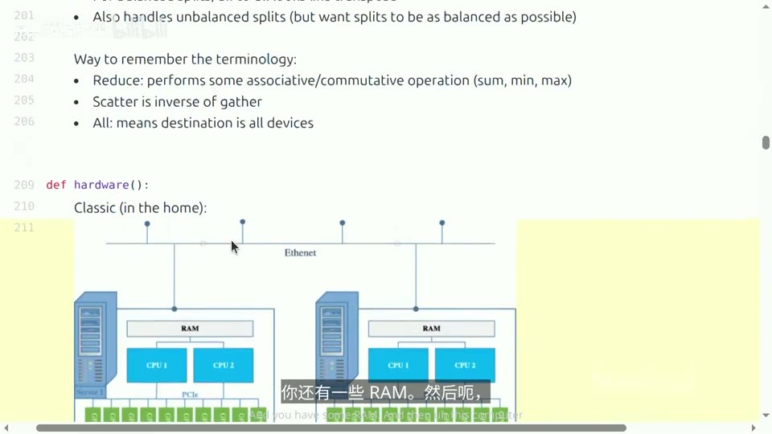 |
| …and so on. That's one particular configuration. [【Jump to 17:35】](https://www.bilibili.com/video/BV11LEA6eEuj/?p=7&t=1055) | 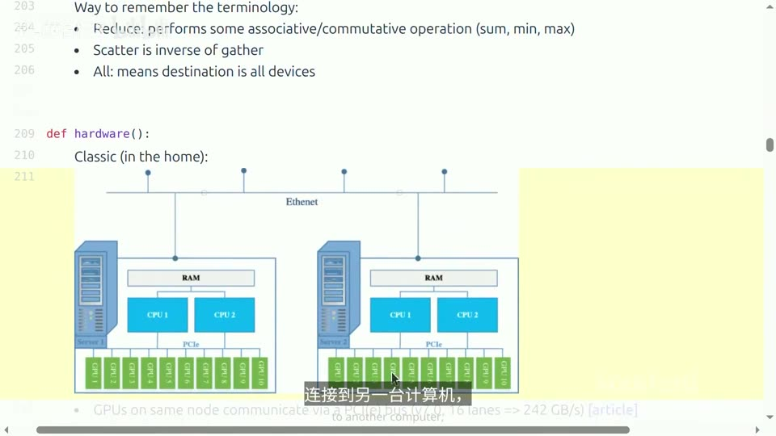 |
| One particular topology: GPUs in the same node talk over PCIe. [【Jump to 17:39】](https://www.bilibili.com/video/BV11LEA6eEuj/?p=7&t=1059) | 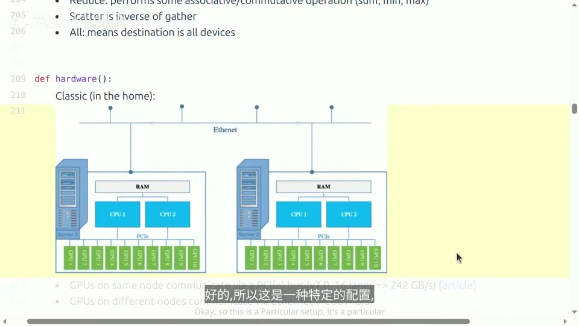 |
| GPUs in different nodes have to go another way — through Ethernet. It's like buying a gaming GPU, connecting it to your friend's machine with a network cable and saying "I'm going to train a large model". That's the only option you have. [【Jump to 17:43】](https://www.bilibili.com/video/BV11LEA6eEuj/?p=7&t=1063) | 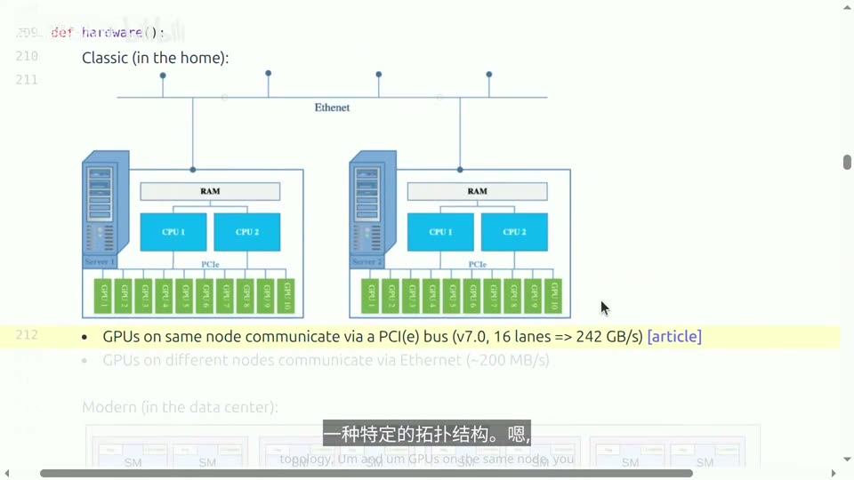 |
| But if you're seriously trying to train, the picture is completely different. [【Jump to 18:00】](https://www.bilibili.com/video/BV11LEA6eEuj/?p=7&t=1080) | 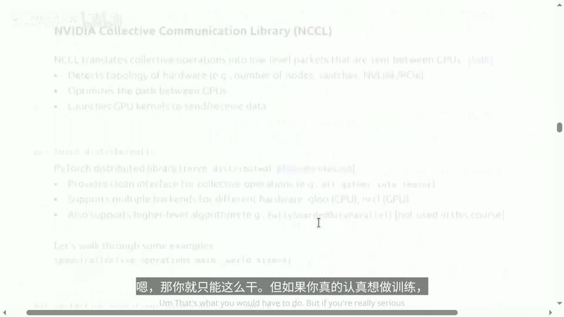 |
| Take the diagram I showed at the start, with the GPUs on it… [【Jump to 18:04】](https://www.bilibili.com/video/BV11LEA6eEuj/?p=7&t=1084) | 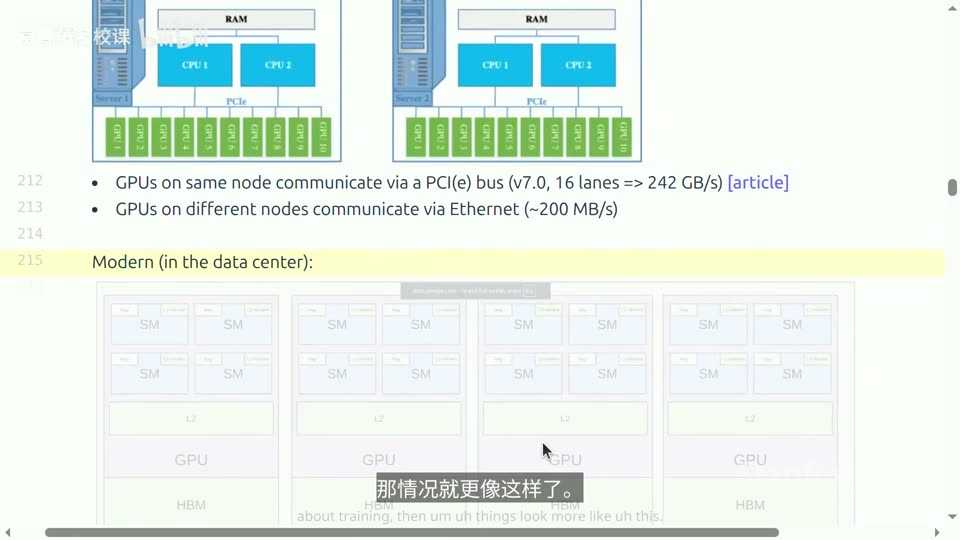 |
| …and things called NVLink, NVSwitch and InfiniBand. So the typical setup looks like this: [【Jump to 18:08】](https://www.bilibili.com/video/BV11LEA6eEuj/?p=7&t=1088) | 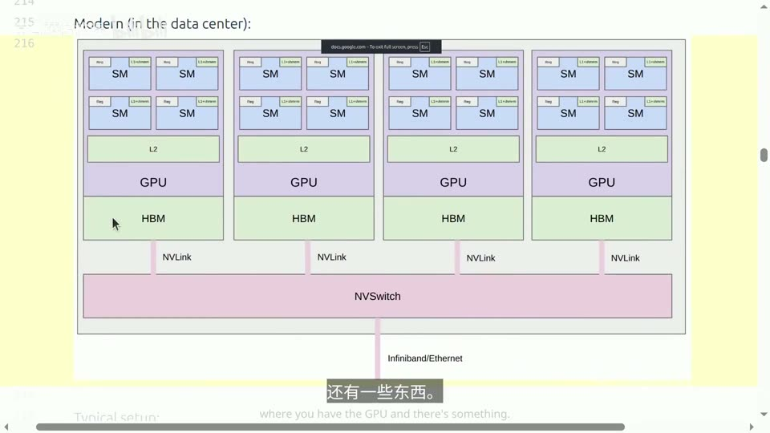 |
| 8 is a typical number here (256 was just an example I made up). A node usually has 8 GPUs, connected to a switch through NVIDIA's NVLink. To give you a sense: with NVLink 5.0 the total bandwidth reaches 1.8 TB/s; remember that a B200's HBM bandwidth is 8 TB/s, so NVLink 5.0 is about a quarter of that. [【Jump to 18:15】](https://www.bilibili.com/video/BV11LEA6eEuj/?p=7&t=1095) | 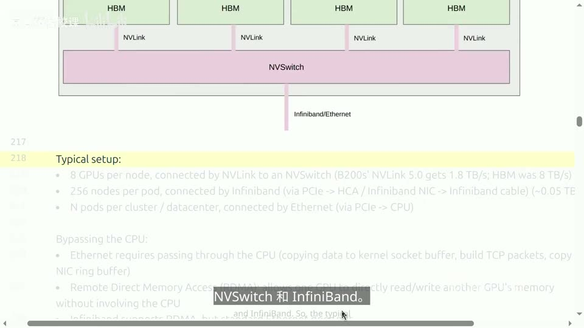 |
| (Slower than HBM) by about four times. But considering this is moving data between devices, it's actually quite fast — obviously not as fast as HBM, which is much faster, but slower than shared memory or L1/L2 cache. Put simply, NVLink to a switch means that from the programming point of view you can treat any GPU as directly connected to any other GPU. [【Jump to 18:42】](https://www.bilibili.com/video/BV11LEA6eEuj/?p=7&t=1122) |  |
| You send data from one GPU to any other, and the hardware takes it to the switch and the switch routes it. And you usually run into this situation: [【Jump to 19:12】](https://www.bilibili.com/video/BV11LEA6eEuj/?p=7&t=1152) |  |
| at some scale you can't get by with NVSwitch and NVLink alone. [【Jump to 19:21】](https://www.bilibili.com/video/BV11LEA6eEuj/?p=7&t=1161) |  |
| You have to do this: as the number of GPUs in a cluster grows, you have to put nodes into pods, connected by InfiniBand. Now things are different — GPUs no longer connect directly to another GPU but have to go through PCIe and so on, and then over dedicated InfiniBand cables, which is much slower with much lower bandwidth. Finally, if InfiniBand isn't enough either… [【Jump to 19:25】](https://www.bilibili.com/video/BV11LEA6eEuj/?p=7&t=1165) |  |
| …and you have these enormous pods, you need to connect them over Ethernet; there the data has to pass through PCIe and actually through the CPU — which, as we'll see, is even slower. So it's a bit like a memory hierarchy: the more nodes you have, the less feasible it is for one NVSwitch to serve something like 100,000 GPUs. One more thing I should mention… [【Jump to 19:55】](https://www.bilibili.com/video/BV11LEA6eEuj/?p=7&t=1195) |  |
| I hinted earlier at this "bypassing the CPU" business, and from the hardware point of view… [【Jump to 20:21】](https://www.bilibili.com/video/BV11LEA6eEuj/?p=7&t=1221) |  |
| …that's an important aspect. With traditional Ethernet, a GPU has to communicate with the CPU just to copy data: it copies the data into the CPU's kernel socket buffer — kernel here means the operating system kernel, not a GPU kernel — then assembles network packets, copies them to the network interface, and sends them out. [【Jump to 20:25】](https://www.bilibili.com/video/BV11LEA6eEuj/?p=7&t=1225) |  |
| That usually adds a lot of latency. Hence the technology called RDMA (remote direct memory access): it lets a GPU read and write another GPU's memory with no CPU involved at all. Obviously, if you're using NVLink and NVSwitch… [【Jump to 20:55】](https://www.bilibili.com/video/BV11LEA6eEuj/?p=7&t=1255) |  |
| …then you have RDMA capability. [【Jump to 21:14】](https://www.bilibili.com/video/BV11LEA6eEuj/?p=7&t=1274) |  |
| InfiniBand supports RDMA too, so GPUs connected over InfiniBand can talk directly without the CPU; standard Ethernet can't. [【Jump to 21:18】](https://www.bilibili.com/video/BV11LEA6eEuj/?p=7&t=1278) |  |
| Two notable developments to mention. NVIDIA keeps pushing hard on what can be done with bigger and bigger clusters: for B200/B300 they brought out something called NVL72 — 9 trays of 8 GPUs each, so 72 GPUs in total, all connected into a single NVLink domain through NVSwitch. [【Jump to 21:29】](https://www.bilibili.com/video/BV11LEA6eEuj/?p=7&t=1289) |  |
| If you remember, NVLink is very fast. So normally, if you're just an ordinary user… [【Jump to 21:56】](https://www.bilibili.com/video/BV11LEA6eEuj/?p=7&t=1316) |  |
| …you'd think: fine, I have 8 GPUs that are extremely fast between themselves, and outside that range speed drops a lot. But if you have enough money… [【Jump to 22:03】](https://www.bilibili.com/video/BV11LEA6eEuj/?p=7&t=1323) |  |
| …you can buy this very high-end hardware and get extremely fast interconnect across as many as 72 GPUs. Another thing to mention: standard Ethernet doesn't support RDMA, but Ethernet has moved on — there's a technology called RoCE, RDMA over Converged Ethernet, which lets Ethernet bypass the CPU. It's an alternative to InfiniBand (which is usually expensive, as are many NVIDIA products). [【Jump to 22:13】](https://www.bilibili.com/video/BV11LEA6eEuj/?p=7&t=1333) |  |
| But with RDMA over Converged Ethernet you can get quite good performance. Meta has published papers showing they're working on this — Llama's training may or may not have used converged Ethernet. OK, that's a brief overview of the hardware situation. [【Jump to 22:43】](https://www.bilibili.com/video/BV11LEA6eEuj/?p=7&t=1363) |  |
| GPUs connect through NVLink to NVSwitch… [【Jump to 23:03】](https://www.bilibili.com/video/BV11LEA6eEuj/?p=7&t=1383) |  |
| …over a range that might be 8 or 72 GPUs, and then out over InfiniBand. [【Jump to 23:07】](https://www.bilibili.com/video/BV11LEA6eEuj/?p=7&t=1387) |  |
| Thank you. Next we'll talk about how to program it. [【Jump to 23:13】](https://www.bilibili.com/video/BV11LEA6eEuj/?p=7&t=1393) |  |
| At the bottom is a library called the NVIDIA Collective Communications Library (NCCL, pronounced "nickel"). It translates collective operations — all-reduce, reduce, broadcast and the rest — into the packets that actually travel between GPUs. When you use NCCL, it's essentially as if you say "I want to do an all-reduce", and NCCL analyses the hardware topology, works out the communication paths between the GPUs, and actually launches GPU kernels to send and receive the data. [【Jump to 23:17】](https://www.bilibili.com/video/BV11LEA6eEuj/?p=7&t=1397) |  |
| Because in the end, remember: everything that runs on a GPU is ultimately a kernel, and there are communication kernels dedicated to talking to other GPUs. OK, we won't dwell on NCCL, just know that it exists. [【Jump to 23:47】](https://www.bilibili.com/video/BV11LEA6eEuj/?p=7&t=1427) |  |
| Next we come to PyTorch. Before that, any questions? — About the hardware, can you describe it concretely? Does it look like racks and trays? [【Jump to 24:03】](https://www.bilibili.com/video/BV11LEA6eEuj/?p=7&t=1443) |  |
| Let me describe racks and trays physically — what are they? As for NVSwitch 2, I'm not a hardware expert… [【Jump to 24:11】](https://www.bilibili.com/video/BV11LEA6eEuj/?p=7&t=1451) |  |
| A rack is, put simply — I've seen data centres — a frame like this, and each tray is roughly like this… [【Jump to 24:22】](https://www.bilibili.com/video/BV11LEA6eEuj/?p=7&t=1462) |  |
| with some stuff inside it. G stands for Grace (CPU). Each tray has two CPUs, each CPU connects to 4 GPUs, so there are 8 GPUs on a tray; they stack up and everything connects to the NVSwitch. [【Jump to 24:28】](https://www.bilibili.com/video/BV11LEA6eEuj/?p=7&t=1468) |  |
| The question is what exactly the difference is between NVLink and RDMA? — You can think of NVLink as more of a hardware or desired-feature… [【Jump to 24:45】](https://www.bilibili.com/video/BV11LEA6eEuj/?p=7&t=1485) |  |
| …while RDMA means one GPU can read and write another GPU's memory. There are several ways to implement RDMA: one over NVLink and NVSwitch, another over InfiniBand. So InfiniBand, NVSwitch and NVLink refer more to hardware — which cables and switches exist — while RDMA refers more to the operational level, to what actually happens during communication. [【Jump to 24:51】](https://www.bilibili.com/video/BV11LEA6eEuj/?p=7&t=1491) |  |
| …that is, during communication. There are other routes and we needn't go into details — RDMA over Converged Ethernet (RoCE), for example, is another implementation. Is it widely used? — Yes. So what is NCCL optimised for? Multi-node clusters? That sounds intuitive, but it actually applies to more general settings. And is NCCL optional? [【Jump to 25:21】](https://www.bilibili.com/video/BV11LEA6eEuj/?p=7&t=1521) |  |
| The question is whether NCCL is aimed at multi-node clusters. — I don't know whether they optimise specifically for that; I don't have the details. All I can say is that NVIDIA has essentially always optimised its whole software stack for inference and training of large models, because their main customers are the big companies and language-model providers — I'd be surprised if they hadn't thought about optimising for this workload. [【Jump to 25:51】](https://www.bilibili.com/video/BV11LEA6eEuj/?p=7&t=1551) |  |
| I'd be surprised. A student is asking towards the camera: what if you have 9 GPUs? How do you distribute the work across them? — It depends on how those 9 GPUs are laid out in your configuration. [【Jump to 26:21】](https://www.bilibili.com/video/BV11LEA6eEuj/?p=7&t=1581) |  |
| Often you assume 8 GPUs per node, so the ninth lands on another node. Without NVLink connecting them, that's bad — the node offers very little compute and communicating with it costs a great deal. But if every device hangs off the NVSwitch, the situation is much more reasonable. OK, one more question and then I'll carry on. [【Jump to 26:51】](https://www.bilibili.com/video/BV11LEA6eEuj/?p=7&t=1611) |  |
| OK, how does this differ from TPU? — Let Tatsu talk about TPUs. TPUs are usually much simpler hardware, and I'm not familiar with exactly how these components correspond, but we can discuss it after class. OK, let's actually write some code to use this hardware. [【Jump to 27:21】](https://www.bilibili.com/video/BV11LEA6eEuj/?p=7&t=1641) |  |
| PyTorch conveniently provides a library, torch.distributed, which gives neat interfaces to these collective operations. [【Jump to 27:48】](https://www.bilibili.com/video/BV11LEA6eEuj/?p=7&t=1668) |  |
| So you don't have to think explicitly about NCCL. In fact the library supports different backends for different hardware: if you're on a GPU you use the NCCL backend; if you're on a CPU there's a thing called gloo — as I said, parallel processing long predates GPUs and you can run these collectives on a CPU too. The library also supports higher-level models and algorithms, which this course doesn't use. [【Jump to 27:55】](https://www.bilibili.com/video/BV11LEA6eEuj/?p=7&t=1675) |  |
| Because we build from scratch. OK, let's walk through a basic example of the collectives. Here's a function called spawn: it takes another function and means "replicate this function four times, with world size 4". Let's see what it does — this is actually a wrapper I wrote… [【Jump to 28:25】](https://www.bilibili.com/video/BV11LEA6eEuj/?p=7&t=1705) |  |
| …mostly to get around the fact that this lecture can't run multiprocessing. Normally you'd call torch.multiprocessing.spawn with that function; I'll use this branch that disables the distributed part. Let's walk through it: I'm now inside this function, which is supposed to run asynchronously for each process. Remember, world size is the number of processes, and the ranks are 0, 1, 2… [【Jump to 28:47】](https://www.bilibili.com/video/BV11LEA6eEuj/?p=7&t=1727) |  |
| …up to world_size minus 1, so there are as many of these functions running at once as there are ranks. OK, I'm rank zero, what do I do? First there's a setup step that configures the master address and port. Note that this isn't really how the GPUs communicate with each other; it's more for generic metadata and coordination. Real data goes over NCCL, otherwise it'd be very slow. If you have GPUs you can use the NCCL backend. [【Jump to 29:17】](https://www.bilibili.com/video/BV11LEA6eEuj/?p=7&t=1757) |  |
| I'm on a laptop, so I'll use the gloo backend. Now we run here, with four such processes. There's a barrier function that works as a synchronisation barrier: once you hit it, it waits until every process has got this far. You can think of the processes as running asynchronously; I can't guarantee one finishes before another, and completion order can be any interleaving. So to make sure certain code runs before other code… [【Jump to 29:47】](https://www.bilibili.com/video/BV11LEA6eEuj/?p=7&t=1787) |  |
| …I put these synchronisation barriers in. The downside of too many barriers is that you can end up waiting unnecessarily. OK, let's try all-reduce: next I create the tensors, and I've included the rank just to make the example more interesting — each rank will hold a different tensor, and I'll print what it has before the all-reduce. [【Jump to 30:17】](https://www.bilibili.com/video/BV11LEA6eEuj/?p=7&t=1817) |  |
| Now if I jump here, let's see what gets printed. [【Jump to 30:43】](https://www.bilibili.com/video/BV11LEA6eEuj/?p=7&t=1843) |  |
| And now, do the all-reduce. [【Jump to 30:47】](https://www.bilibili.com/video/BV11LEA6eEuj/?p=7&t=1847) |  |
| Before, rank zero had [0,1,2,3]… [【Jump to 30:51】](https://www.bilibili.com/video/BV11LEA6eEuj/?p=7&t=1851) |  |
| rank one had [1,2,3,4], and so on — the same as the example I showed earlier. Note the print statements appear in an order the hardware decides, since it's running asynchronously, but all the data is there. So now if I do the all-reduce… [【Jump to 30:55】](https://www.bilibili.com/video/BV11LEA6eEuj/?p=7&t=1855) |  |
| …you pass these in as arguments. It takes the tensor, you pass the reduction operation (sum here), and you say not to do it asynchronously. It calls — gloo in this case, possibly NCCL — launches GPU kernels to do the communication, handles everything for you, and basically writes the data in place. So after the all-reduce… [【Jump to 31:11】](https://www.bilibili.com/video/BV11LEA6eEuj/?p=7&t=1871) |  |
| I get the result of the all-reduce: the sum of each column, copied to every rank. Thank you. [【Jump to 31:39】](https://www.bilibili.com/video/BV11LEA6eEuj/?p=7&t=1899) |  |
| That's all-reduce. If you wanted to be fancier and do it asynchronously, you'd set async_op=True, but that would mess up all these print statements, so I tried to insert more barriers than usual. A question… [【Jump to 31:48】](https://www.bilibili.com/video/BV11LEA6eEuj/?p=7&t=1908) |  |
| The question is about the mapping from rank to GPU — in this course a rank is a GPU. Let's look at another example: I'm going to do a reduce-scatter. Here I create an input from 0 to world_size and allocate space for the output. So what does it look like before I do the reduce-scatter? [【Jump to 32:02】](https://www.bilibili.com/video/BV11LEA6eEuj/?p=7&t=1922) |  |
| It looks like… every piece is much the same; input and output happen to be zero, but they could be anything. Then I do the reduce-scatter: here I don't write in place, I pass an output tensor and an input tensor separately and specify a sum. What comes out: the input is essentially untouched… [【Jump to 32:32】](https://www.bilibili.com/video/BV11LEA6eEuj/?p=7&t=1952) |  |
| …but in the output, the reduced value of each component has landed on its corresponding rank. [【Jump to 33:02】](https://www.bilibili.com/video/BV11LEA6eEuj/?p=7&t=1982) |  |
| Thanks. The question is how you do an all-reduce asynchronously. That is… [【Jump to 33:13】](https://www.bilibili.com/video/BV11LEA6eEuj/?p=7&t=1993) |  |
| …it's somewhat like a monolithic operation: you say "do an all-reduce" and it launches kernels to do the communication. And remember that CUDA itself is already asynchronous relative to the process; now we're making all the processes asynchronous too, and the key is that this code returns immediately and you can go and do something else. So one typical approach — which I won't go into in this lecture — is to overlap computation and communication. [【Jump to 33:20】](https://www.bilibili.com/video/BV11LEA6eEuj/?p=7&t=2000) |  |
| For instance you can run this operation and then go load other data you need for the next step, because that data is independent of the operation; when you want to confirm everything is really done, you call wait() or a barrier. OK, let's do the last one — all-gather. By now you probably get the general idea. Here I take the reduce-scatter output as input and allocate an output buffer first… [【Jump to 33:50】](https://www.bilibili.com/video/BV11LEA6eEuj/?p=7&t=2030) |  |
| …so the all-gather process earlier was like this… [【Jump to 34:20】](https://www.bilibili.com/video/BV11LEA6eEuj/?p=7&t=2060) |  |
| Here I have the result from reduce-scatter; this output buffer was just allocated and happens to contain some values, but never mind. Then after I all-gather into the tensor… [【Jump to 34:24】](https://www.bilibili.com/video/BV11LEA6eEuj/?p=7&t=2064) |  |
| …I get… [【Jump to 34:34】](https://www.bilibili.com/video/BV11LEA6eEuj/?p=7&t=2074) |  |
| …all the different inputs, with the data gathered onto every rank. Here you can see it really is so. [【Jump to 34:43】](https://www.bilibili.com/video/BV11LEA6eEuj/?p=7&t=2083) |  |
| We've shown by example that all-reduce really is reduce-scatter plus all-gather. Let me wrap up: do the setup as I did at the start, then clean up the environment — cleaning up after yourself is a good habit. That's your first torch.distributed program. OK, so let's do some… [【Jump to 34:56】](https://www.bilibili.com/video/BV11LEA6eEuj/?p=7&t=2096) |  |
| …benchmarking. This will be quick, because I want to get to part two. So how fast is communication? Let's do an all-reduce: here I'll all-reduce a hundred million elements — oops, sorry, I got that wrong. OK, I'll do it. Create a tensor with that many elements, and remember to warm up before benchmarking, as before; here I'll call cuda.synchronize and a barrier. [【Jump to 35:26】](https://www.bilibili.com/video/BV11LEA6eEuj/?p=7&t=2126) |  |
| …just to be sure — because there are two kinds of asynchrony here, the CUDA kernels and the different processes, and I want to make sure everything is synchronised, even if some operations had actually finished before we started. Then do the all-reduce, and after that wait on a barrier again and stop the clock. Remember, this runs on every rank. [【Jump to 35:56】](https://www.bilibili.com/video/BV11LEA6eEuj/?p=7&t=2156) |  |
| So if I look at the output here: for rank 0, 2, 1, 3… [【Jump to 36:22】](https://www.bilibili.com/video/BV11LEA6eEuj/?p=7&t=2182) |  |
| …I get possibly different times, because they're independent processes and each reports its own measurement; if you want a single number you can average them. [【Jump to 36:26】](https://www.bilibili.com/video/BV11LEA6eEuj/?p=7&t=2186) |  |
| …so one useful thing to do now — like when we compute MFU — is to work out the effective bandwidth. The idea is this… [【Jump to 36:40】](https://www.bilibili.com/video/BV11LEA6eEuj/?p=7&t=2200) |  |
| That took 1.6 milliseconds. Is that good or bad? [【Jump to 36:54】](https://www.bilibili.com/video/BV11LEA6eEuj/?p=7&t=2214) |  |
| To compute effective bandwidth you first work out how many bytes were actually sent, then divide that by the total time. The size of the data sent is the size of each element times the number of elements — basically the total bytes of the tensor. But how many bytes are actually sent needs a bit of unpacking, and for an all-reduce… [【Jump to 36:58】](https://www.bilibili.com/video/BV11LEA6eEuj/?p=7&t=2218) |  |
| …to simplify, suppose you add the values of ranks 0, 1, 2, 3: that involves world_size−1 additions overall, so it takes world_size−1 iterations — that's where the factor comes from; the 2 is there because you both send and reduce; multiply by the payload size and you have the total bytes sent. The total duration is the time actually taken, multiplied by world_size (the total weighted over all ranks)… [【Jump to 37:28】](https://www.bilibili.com/video/BV11LEA6eEuj/?p=7&t=2248) |  |
| …so the bandwidth is bytes sent divided by total duration. [【Jump to 37:58】](https://www.bilibili.com/video/BV11LEA6eEuj/?p=7&t=2278) |  |
| In this case the result is about 400 GB per second. [【Jump to 38:07】](https://www.bilibili.com/video/BV11LEA6eEuj/?p=7&t=2287) |  |
| A few things to say here. First, look at the expression: effective bandwidth = data size × 2 × (world_size−1) ÷ (world_size × duration). As world_size grows, (world_size−1)/world_size approaches 1, so effectively you're left with data size × 2 ÷ duration — which is essentially the bandwidth itself. Note that it's independent of world size. [【Jump to 38:11】](https://www.bilibili.com/video/BV11LEA6eEuj/?p=7&t=2291) |  |
| That's good: as you add GPUs the bandwidth stays the same, and it's also independent of topology (whether NCCL picks ring or tree). OK, that's all-reduce. reduce-scatter is very similar: create the input and output, warm up, run the operation and time it. [【Jump to 38:41】](https://www.bilibili.com/video/BV11LEA6eEuj/?p=7&t=2321) |  |
| There are the timings for reduce-scatter. [【Jump to 39:06】](https://www.bilibili.com/video/BV11LEA6eEuj/?p=7&t=2346) |  |
| You can measure effective bandwidth here too: count the bytes of the input data, which is the bytes sent — note there's no factor of 2 here — and divide by the total time to get the bandwidth. [【Jump to 39:10】](https://www.bilibili.com/video/BV11LEA6eEuj/?p=7&t=2350) |  |
| The result should be very similar; there's some randomness sometimes, but roughly in the 400s. A few points here… [【Jump to 39:27】](https://www.bilibili.com/video/BV11LEA6eEuj/?p=7&t=2367) |  |
| Remember that all-reduce consists of reduce-scatter plus all-gather, so of course it moves twice the volume of data — reduce-scatter costs something and all-gather costs something. all-reduce does twice the work, but it also takes twice the time, the two cancel out, and you get the same bandwidth. [【Jump to 39:36】](https://www.bilibili.com/video/BV11LEA6eEuj/?p=7&t=2376) |  |
| That's the end of part one. Any questions before I move to part two? — Why does that operation have to be synchronous? [【Jump to 40:06】](https://www.bilibili.com/video/BV11LEA6eEuj/?p=7&t=2406) |  |
| Why do we have to synchronise for the kernel? In the end we're still running CUDA operations, just with several processes, each with a GPU, running some CUDA work. [【Jump to 40:36】](https://www.bilibili.com/video/BV11LEA6eEuj/?p=7&t=2436) |  |
| If you're running a CUDA operation, remember it's asynchronous by default, so when you reach the next line of Python that operation may not have finished; hence we use synchronize to make sure it has. And conversely — must the barrier come before synchronize? Not necessarily; it depends on how the device reads the code. [【Jump to 41:06】](https://www.bilibili.com/video/BV11LEA6eEuj/?p=7&t=2466) |  |
| …if you call the barrier first while the kernel hasn't finished… [【Jump to 41:14】](https://www.bilibili.com/video/BV11LEA6eEuj/?p=7&t=2474) |  |
| …it's still running, and you immediately hit the barrier, so you just synchronise different calls separately and nothing is really synchronised. OK, let's keep going. Now we'll talk about how to train a model. [【Jump to 41:22】](https://www.bilibili.com/video/BV11LEA6eEuj/?p=7&t=2482) |  |
| Next we'll go through a very basic MLP training implementation — a multi-layer MLP. A bit redundant, I suppose, since MLP already stands for multi-layer perceptron. [【Jump to 41:31】](https://www.bilibili.com/video/BV11LEA6eEuj/?p=7&t=2491) |  |
| Don't forget that the MLP is where the real compute bottleneck of a Transformer sits, so the example is quite representative. Data parallelism, tensor parallelism, pipeline parallelism — hold this picture in your head. [【Jump to 41:41】](https://www.bilibili.com/video/BV11LEA6eEuj/?p=7&t=2501) |  |
| This is a sketch, don't overthink it; it's mainly there to help you see how the data and the parameters get split. Data parallelism splits the data into pieces, with each GPU taking part of it, while I keep all the parameters as usual and train the model normally. [【Jump to 41:55】](https://www.bilibili.com/video/BV11LEA6eEuj/?p=7&t=2515) |  |
| Then I need to synchronise. Let me explain how this works. I'll generate some sample data: batch size 128, dimension 124, so a matrix of batch size × dimension. Straight in — this is data parallelism. How it works: with this data matrix, I split the shape into as many pieces as world size, 4 here. [【Jump to 42:15】](https://www.bilibili.com/video/BV11LEA6eEuj/?p=7&t=2535) |  |
| Each rank gets one piece. I call each piece the local batch size, batch size divided by world size — each GPU sees 32 rows. This is the starting index; with start and end indices you can slice out that piece of data and put it on that rank. So now each GPU holds its own data tensor. [【Jump to 42:45】](https://www.bilibili.com/video/BV11LEA6eEuj/?p=7&t=2565) |  |
| …that is, it handles that part of the data. In practice each rank normally loads its own data to avoid a bottleneck; here it's just for convenience. Next we instantiate an MLP: suppose we've fixed the number of layers; for each layer I'll use a matrix of size num_dim × num_dim. [【Jump to 43:15】](https://www.bilibili.com/video/BV11LEA6eEuj/?p=7&t=2595) |  |
| I just initialise a set of random parameters and hand them to the optimiser. Here's the training loop: in the forward pass I get the data — remember this isn't all the data; if I'm rank 2 I only get part of it; I go through the layers for the forward pass, then do the backward pass. Normally that's where it ends. [【Jump to 43:45】](https://www.bilibili.com/video/BV11LEA6eEuj/?p=7&t=2625) |  |
| But now remember: each rank has different data, and therefore different gradients. This is exactly the step that makes data parallelism work — we synchronise gradients across all the workers. It's the only difference between standard training and DDP, and it's quite elegant and concise: do one all-reduce over all parameters (on param.grad) and take the average. After the all-reduce… [【Jump to 44:15】](https://www.bilibili.com/video/BV11LEA6eEuj/?p=7&t=2655) |  |
| …every rank now has exactly the same gradients, and then you just update the parameters. I find that elegant: it's essentially standard training, only on your local batch, with this inserted after the backward pass. We average all the gradients with one all-reduce, and once the code has run the parameters are updated. So during training each rank looks like it's updating parameters using all the data… [【Jump to 44:45】](https://www.bilibili.com/video/BV11LEA6eEuj/?p=7&t=2685) |  |
| …but actually it only processed part of it. That's basically DDP, the first data-parallel method. Any questions on this? — Does this only work if the batch size is greater than 1? [【Jump to 45:15】](https://www.bilibili.com/video/BV11LEA6eEuj/?p=7&t=2715) |  |
| For this to really make sense, the batch size must be at least world size, and usually should be larger. Does the batch size have to be a multiple of world size? A multiple is better; if not, you can pad with zeros or do some padding, so there are ways, it's just that with a multiple everyone's life is easier. [【Jump to 45:29】](https://www.bilibili.com/video/BV11LEA6eEuj/?p=7&t=2729) |  |
| Everyone's life is easier. (A student asks) Could you talk about DDP for a Transformer? And how likely is it to be a stopgap? [【Jump to 45:53】](https://www.bilibili.com/video/BV11LEA6eEuj/?p=7&t=2753) |  |
| What does it look like with a Transformer? — It's basically the same. One good thing about DDP is that it's very modular: you do your forward pass as usual, and DDP just averages the parameters here; it doesn't care what your forward pass looks like. OK, I'll carry on. [【Jump to 46:01】](https://www.bilibili.com/video/BV11LEA6eEuj/?p=7&t=2761) |  |
| That's DDP. To summarise: the loss differs across ranks and the gradients start out different, but they're all reduced and made consistent across ranks, so the parameters stay identical. Next class Tatsu will cover the more advanced data-parallel techniques, FSDP and ZeRO. As I mentioned, here we use all-reduce — it's like a very simple monolithic operation, but it does require all the model's parameters… [【Jump to 46:26】](https://www.bilibili.com/video/BV11LEA6eEuj/?p=7&t=2786) |  |
| …to stay in memory. But what if the parameters are too large to fit? Then you need something cleverer, which is exactly the topic of the next lecture. [【Jump to 46:56】](https://www.bilibili.com/video/BV11LEA6eEuj/?p=7&t=2816) |  |
| Now let me talk about tensor parallelism. The idea is to cut in this direction… [【Jump to 47:07】](https://www.bilibili.com/video/BV11LEA6eEuj/?p=7&t=2827) |  |
| …by which I mean we don't split the data, we split each layer — each rank gets part of every layer. Usually this means the volume of data we need to transfer is much larger, which we'll come back to. [【Jump to 47:11】](https://www.bilibili.com/video/BV11LEA6eEuj/?p=7&t=2831) |  |
| What does tensor parallelism look like concretely? A simplifying assumption first: each rank holds all the data, with dimension batch size × num_dim. I'll define a local_num_dim: for this rank I only handle part of the dimensions. What the sketch means: each model still contains all the layers, but for each layer the number of parameters is num_dim × some local number. [【Jump to 47:36】](https://www.bilibili.com/video/BV11LEA6eEuj/?p=7&t=2856) |  |
| Suppose this is the parameter matrix of one layer; I split it along the columns, which is called column-wise tensor parallelism; you can split by rows too, but we won't discuss that now. So how does the forward pass actually go? I should go through all the layers and compute activations: starting from X (the data), access the parameters of layer… [【Jump to 48:06】](https://www.bilibili.com/video/BV11LEA6eEuj/?p=7&t=2886) |  |
| Look, this is only part of the parameters. If I'm rank one I only get this part of the matrix, but I can still go on — I can apply the nonlinearity, because it works element-wise anyway. But now what I do is communicate the activations: if I have a data matrix, rank one holds the partial activations corresponding to this part of the matrix… [【Jump to 48:36】](https://www.bilibili.com/video/BV11LEA6eEuj/?p=7&t=2916) |  |
| and so on for the activations. And I basically need all the activations on all the ranks, which we know how to do — we covered the collective-communication language all-gather earlier. So I take all the activations, of shape batch size × local dimension, and I do an all-gather… [【Jump to 49:06】](https://www.bilibili.com/video/BV11LEA6eEuj/?p=7&t=2946) |  |
| Here I'm allocating memory for the activations; X is the actual part of the activations, of shape batch size times local dimension. all-gather means every rank holds X, every rank allocates a list of activations with as many elements as world size; after all-gather, X is copied into its corresponding slot. Once I've collected all the activations… [【Jump to 49:36】](https://www.bilibili.com/video/BV11LEA6eEuj/?p=7&t=2976) |  |
| …I concatenate them into a full-width X, of shape batch size times total dimension. Any questions about column tensor parallelism? This happens at every layer. Note the difference from data parallelism: here we have to do something to the model itself. Data parallelism is elegant because it splits by data and treats the model as one module; but here we have to modify the model. [【Jump to 50:06】](https://www.bilibili.com/video/BV11LEA6eEuj/?p=7&t=3006) |  |
| This largely exploits the fact that a matrix multiplication can be broken into a set of small matrix multiplications, which we can run on different ranks and then combine. And in the backward pass? Guess… Right, the question is what happens in the backward pass: in the backward pass you have activations… [【Jump to 50:36】](https://www.bilibili.com/video/BV11LEA6eEuj/?p=7&t=3036) |  |
| …and you need to do reduce-scatter, distributing to all the different parts. But in some sense… [【Jump to 51:06】](https://www.bilibili.com/video/BV11LEA6eEuj/?p=7&t=3066) |  |
| all-gather and reduce-scatter have this complementary character: in the forward pass… [【Jump to 51:10】](https://www.bilibili.com/video/BV11LEA6eEuj/?p=7&t=3070) |  |
| if you do all-gather, then in the backward pass you do reduce-scatter. And is that done automatically by autograd? — No. If you just call backward it won't do it, because there's no parallelism in it. But PyTorch does ship all of this, and much of it is done for you automatically. [【Jump to 51:15】](https://www.bilibili.com/video/BV11LEA6eEuj/?p=7&t=3075) |  |
| If I went the other way (using PyTorch's own parallelism), roughly what would I have to add? How much of the code would I have to change, and how much stays as it is? Here, what's done for you and what isn't? — Here we manage these things quite explicitly by hand: I don't call the usual autodiff backward, I have to manage it and call reduce-scatter myself. [【Jump to 51:36】](https://www.bilibili.com/video/BV11LEA6eEuj/?p=7&t=3096) |  |
| Yes, this is deliberately designed that way, because this is CS336, "build a language model from scratch". In practice you usually wouldn't have to do this. OK, let's go through pipeline parallelism quickly: the idea is to split the network like this, each rank takes a subset of the layers but keeps all the dimensions within each layer; one rank holds all the data… [【Jump to 52:06】](https://www.bilibili.com/video/BV11LEA6eEuj/?p=7&t=3126) |  |
| Every rank sees all the data in some form. That's how it works. We have all the data, again of size batch size × num_dim; I split the layers, so local_num_layers is the number of layers each rank handles, and then there are local_params — essentially the parameters of those local layers. But inside each layer… [【Jump to 52:36】](https://www.bilibili.com/video/BV11LEA6eEuj/?p=7&t=3156) |  |
| …I do a num_dim × num_dim computation. One thing Tatsu may go into on Wednesday: is this the micro-batch idea? — Let me just show it and explain why it's arranged this way. Besides splitting the layers, I also split the batch into many micro-batches. If I'm rank zero, I take the data and split it into a number of micro-batches (groups of 4 here)… [【Jump to 53:06】](https://www.bilibili.com/video/BV11LEA6eEuj/?p=7&t=3186) |  |
| …right, not the micro-batch — what I do is receive: receive from the previous rank, run the forward pass only over the layers assigned to this rank, and send to the next rank. So here I'm actually using receive and send operations, which are point-to-point communication; I didn't cover those in detail. [【Jump to 53:36】](https://www.bilibili.com/video/BV11LEA6eEuj/?p=7&t=3216) |  |
| But they're fairly intuitive: I'm rank i, I receive a tensor from rank i−1 and send a tensor to rank i+1. I'll explain why when we discuss micro-batches, and Tatsu will say more on Wednesday. That's pipeline parallelism: one rank takes the data… [【Jump to 54:06】](https://www.bilibili.com/video/BV11LEA6eEuj/?p=7&t=3246) |  |
| …processes some layers, and passes it to the next GPU; that GPU processes some layers and passes it on. [【Jump to 54:36】](https://www.bilibili.com/video/BV11LEA6eEuj/?p=7&t=3276) |  |
| This is a very natural way to split a deep network, but the problem is that it creates so-called pipeline bubbles. [【Jump to 54:45】](https://www.bilibili.com/video/BV11LEA6eEuj/?p=7&t=3285) |  |
| That is, you're idly waiting for another tensor to be processed. [【Jump to 54:52】](https://www.bilibili.com/video/BV11LEA6eEuj/?p=7&t=3292) |  |
| Not computing. That ends up being quite inefficient. So the idea of a micro-batch is to split the data into smaller batches. [【Jump to 54:58】](https://www.bilibili.com/video/BV11LEA6eEuj/?p=7&t=3298) |  |
| Then you can process and pass them on quickly, which reduces those pipeline bubbles. One more point: this very basic version doesn't handle overlapping computation and communication, which actually matters a lot for pipeline parallelism. It basically gives you the right structure — if you put an i in front of these operations (as in isend/irecv) they become asynchronous, and you add some code to manage them. The idea is: while you compute here, you can receive or send at the same time. [【Jump to 55:03】](https://www.bilibili.com/video/BV11LEA6eEuj/?p=7&t=3303) |  |
| So computation and communication should overlap, which cuts the time actually spent waiting. There's material here that wasn't covered and that I hope to come back to, namely overlapping communication and computation — especially critical in pipeline parallelism. I didn't mention the data-parallel case either, and it's the same: here I did a single forward pass and then all these all-reduces at the end; but handled properly, a gradient can start being sent the moment it's computed in the backward pass… [【Jump to 55:33】](https://www.bilibili.com/video/BV11LEA6eEuj/?p=7&t=3333) |  |
| …so you overlap communication and computation more fully. Someone asked about general models — I think this MLP covers most of what you need to understand the basics. [【Jump to 56:03】](https://www.bilibili.com/video/BV11LEA6eEuj/?p=7&t=3363) |  |
| Some larger models need a lot more laying out. [【Jump to 56:17】](https://www.bilibili.com/video/BV11LEA6eEuj/?p=7&t=3377) |  |
| So it's harder to see the core algorithm clearly. There are also other kinds of parallelism we haven't covered, such as sequence parallelism — splitting the whole sequence into chunks so that attention computation can be parallelised — and expert parallelism, which parallelises the experts in an MoE, which is where the all-to-all communication I mentioned earlier comes in. And various combinations of these techniques… [【Jump to 56:22】](https://www.bilibili.com/video/BV11LEA6eEuj/?p=7&t=3382) |  |
| …also come up, and the assignments cover them. One thing to note: which technique you choose depends heavily on the hardware. Tensor parallelism, for example, involves a lot of communication — for every layer you need to send a fairly large number of activations — so generally tensor parallelism is done inside a node… [【Jump to 56:52】](https://www.bilibili.com/video/BV11LEA6eEuj/?p=7&t=3412) |  |
| …that is, where there's high-bandwidth NVLink. [【Jump to 57:14】](https://www.bilibili.com/video/BV11LEA6eEuj/?p=7&t=3434) |  |
| Conversely, you wouldn't go outside the NVLink domain… [【Jump to 57:18】](https://www.bilibili.com/video/BV11LEA6eEuj/?p=7&t=3438) |  |
| …to use tensor parallelism. As for pipeline parallelism, you see people using it and it generally tolerates much slower interconnects — some decentralised training work uses pipeline parallelism because the GPU nodes really are scattered around the world; but in that setting you wouldn't want tensor parallelism. So looking at these combinations, it's usually tensor parallelism inside a node… [【Jump to 57:22】](https://www.bilibili.com/video/BV11LEA6eEuj/?p=7&t=3442) |  |
| …then data parallelism or FSDP if needed, and finally pipeline parallelism across nodes. Other factors too: for instance with data parallelism you can often go quite wide, but then you hit the so-called critical batch size — if you increase the batch size too much it stops helping and you're just wasting compute. [【Jump to 57:52】](https://www.bilibili.com/video/BV11LEA6eEuj/?p=7&t=3472) |  |
| In that case tensor parallelism is the better choice. There's a lot to weigh here, and we'll go into it in later classes. One last addition on the TPU I mentioned briefly: note that we deliberately chose PyTorch, and not just PyTorch but a very basic way of calling the collectives, so that you can see clearly. The other way — especially if you're on JAX/TPU — is that you just define the model and a sharding strategy… [【Jump to 58:22】](https://www.bilibili.com/video/BV11LEA6eEuj/?p=7&t=3502) |  |
| …and the compiler actually handles a lot of the decisions, essentially determining what communication operations you need. You basically say "this piece of data has to be here, here and here", and the compiler works out the rest with some magic. That's genuinely attractive, but obviously you lose a lot of the fun of building things from scratch. A quick summary: there are many ways to parallelise — you can split by data, by tensor or by expert… [【Jump to 58:52】](https://www.bilibili.com/video/BV11LEA6eEuj/?p=7&t=3532) |  |
| …or by pipeline or by sequence. We discussed data parallelism, where only DDP came up; next time we'll cover FSDP and ZeRO. As I mentioned, tensor parallelism has very high interconnect requirements, pipeline a little less, but you have to work at reducing the bubbles. Seen more broadly, this pattern is common — you can recompute, or store state in memory or on different GPUs, as we discussed with activation checkpointing. [【Jump to 59:22】](https://www.bilibili.com/video/BV11LEA6eEuj/?p=7&t=3562) |  |
| …seen that way, in data parallelism you do redundant work (every rank actually updates the parameters and tracks all of them), and you do it because you don't have to move optimizer state between devices. On the one hand hardware keeps getting faster… [【Jump to 59:52】](https://www.bilibili.com/video/BV11LEA6eEuj/?p=7&t=3592) |  |
| …but in some sense we always want larger models, so the idea of "go hierarchical" will keep applying. OK, that's it for today… [【Jump to 60:22】](https://www.bilibili.com/video/BV11LEA6eEuj/?p=7&t=3622) |  |
| …that's all. Next Wednesday Tatsu will go deeper into more parallelism techniques. [【Jump to 60:36】](https://www.bilibili.com/video/BV11LEA6eEuj/?p=7&t=3636) |  |